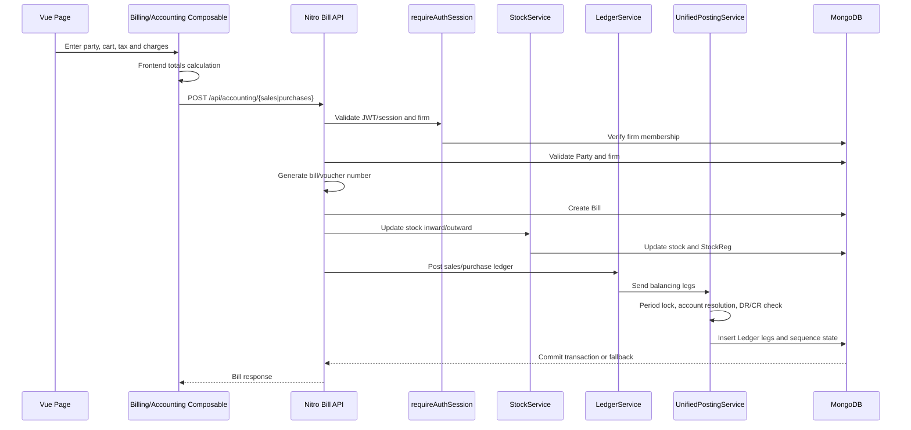
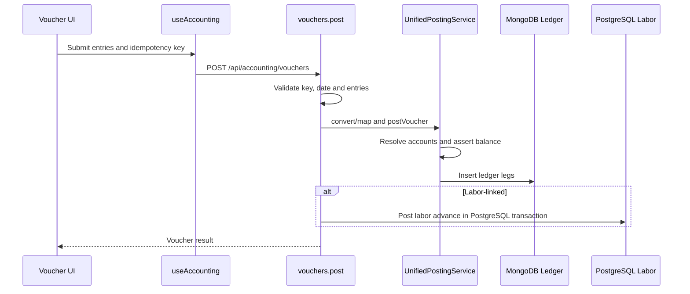
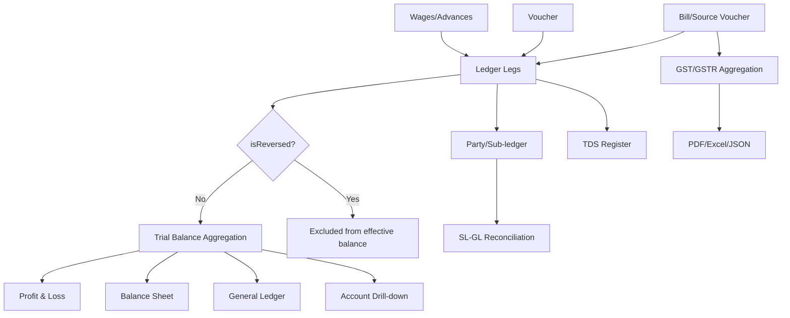
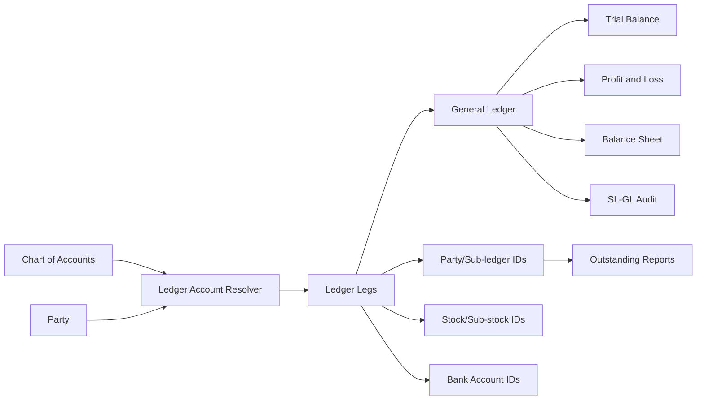
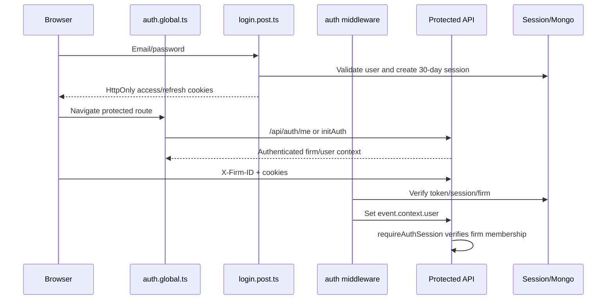
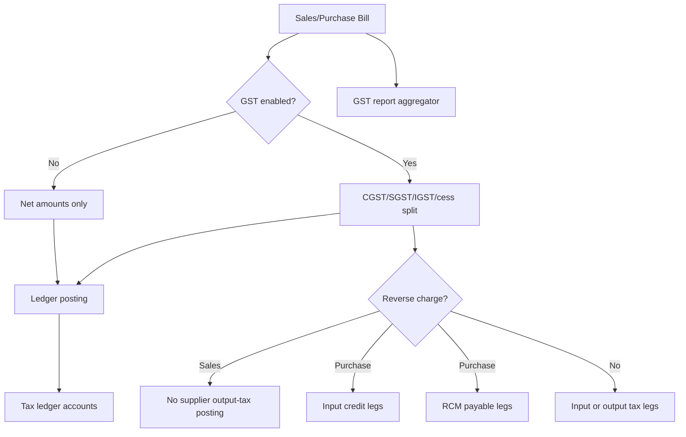

# Accounting System Deep Code Audit

**Audit date:** 2026-11-20  
**Scope:** Repository-wide discovery and evidence-based review of the accounting application, with emphasis on accounting integrity, backend/database behavior, authentication, frontend complexity, and maintainability.  
**Source review status:** Read-only application review. No application source files were modified, no migrations or destructive operations were run, and no production database was accessed.

## 1. Executive Summary

The application is a broad Nuxt 4 ERP suite rather than a narrowly focused accounting program. It combines:

- Accounting and inventory
- Sales and purchase billing
- Bank and statement workflows
- GST and TDS
- Wages and labor ledgers
- Master-roll operations
- Mail and chat
- Work tracking
- AI and administrative features

The accounting core has some strong controls: it uses MongoDB transactions on many posting paths, performs double-entry balance checks, provides effective-ledger filtering, maintains period locks, and has idempotency mechanisms for voucher posting. However, the implementation is not consistently simple or consistently safe.

### Direct answers

**How well structured is the application?**  
The central accounting services are directionally well structured because most GL writes pass through `UnifiedPostingService`, and account resolution is centralized in `LedgerService`/`ledger-account-resolver`. But cross-module coupling is high. Accounting, inventory, labor, PostgreSQL, MongoDB, GST reports, and UI totals are synchronized through many separate paths. Legacy and unified posting APIs coexist.

**Is the application unnecessarily over-engineered?**  
Partly. The unified posting and period-lock infrastructure is justified for a financial system. It becomes less justified where it is paired with many legacy adapters, duplicated sales/purchase implementations, duplicate total calculations, fallback transaction modes, and repeated frontend export/download logic.

**Which parts are unnecessarily complicated?**  
- Sales and purchase flows contain duplicated tax, charge, stock, and ledger behavior across accounting and inventory variants.
- Bills, accounting sales/purchases, stock sales/purchases, and vouchers overlap as separate entry paths.
- The frontend has many separate accounting and invoice composables.
- The voucher delete flow marks rows reversed rather than posting a visible counter-entry.
- Mongo and PostgreSQL synchronization uses retry/logging patterns that cannot guarantee cross-database atomicity.
- GST reports combine bill data, tax tables, and return logic in ways that can diverge from posted ledgers.

**Highest technical debt:** Year-end closing, bill cancellation/editing, voucher deletion, labor/Mongo dual-database synchronization, GST return aggregation, TDS reporting, and the lack of accounting test coverage.

**Are accounting workflows correctly connected?**  
Many core workflows are connected: bill creation updates inventory and calls the unified ledger posting service; reports read ledger or bill models; period locks feed the posting service. But several workflows are incomplete or internally inconsistent: voucher deletion is not a reversal, edited-bill cancellation can reverse both old and superseded versions, GST reports do not fully reconcile to the GL, and cross-database synchronization is only eventually consistent at best.

**Serious financial-integrity risks:**  
Confirmed high-risk issues include edited-bill cancellation producing incorrect reversals, voucher deletion leaving no counter-entry, and unrestricted period-lock/year-end operations by ordinary firm members. GST and RCM omissions are also material. Dual-database consistency remains a suspected but unresolved risk.

**Security weaknesses:**  
The application has substantial authentication controls, including firm scoping and HttpOnly cookies. Key weaknesses are role checks missing from irreversible accounting operations, a second refresh-token JSON transport, and an accounting TDS export path that bypasses the central authenticated API utility.

**What can simplify safely?**  
- Consolidate shared invoice total calculations.
- Consolidate accounting and billing composable responsibilities.
- Replace direct TDS export logic with the central API download utility.
- Make voucher cancellation create a reversal voucher consistently.
- Centralize exact paise and tax calculations.
- Remove body refresh-token compatibility once it is no longer required.
- Reduce duplicate report/export aggregators.

**Fix first:**
1. Protect year-end close and period-lock/unlock operations with explicit admin/owner authorization.
2. Add a complete reversal-only/compensating-entry model for voucher deletion and edited-bill cancellation.
3. Add server Zod validation to accounting mutations.
4. Correct GST/RCM reporting and reconcile return figures to ledger postings.
5. Add accounting transaction and idempotency tests.

---

## 2. Repository Architecture Overview

### Application stack

| Area | Evidence |
|---|---|
| Frontend | Nuxt 4.5.1, Vue 3.5.40, Nuxt UI 4.10.0 |
| Backend | Nitro/Nuxt server routes; Node server preset |
| Primary accounting database | MongoDB through Mongoose 9.9.0 |
| Labor database | PostgreSQL through `postgres` 3.4.9 |
| Cache/session coordination | Upstash Redis |
| External archive/search | Couchbase HTTP query service |
| Authentication | Firebase/Custom JWT/Session hybrid components |
| Validation | Zod dependency, plus route-local manual validation |
| Reporting/export | PDFKit, PDFMake, ExcelJS, XLSX |
| Testing | No established unit/integration/E2E framework found |

Evidence: [package.json](package.json:1-59), [nuxt.config.ts](nuxt.config.ts:1-72).

### Source areas

- `app/pages/accounting/`: accounting entry pages
- `app/components/accounting/`: voucher, ledger, invoice, party, tax, and close components
- `app/composables/`: 28 Vue composables; accounting-specific state is spread across several billing, accounting, GST, TDS, banking, labor, and inventory composables
- `server/api/accounting/`: accounting routes
- `server/utils/accounting/`: posting, ledger, period lock, closing, bill, and tax helpers
- `server/models/`: 33 Mongoose models
- `server/api/labor/` and `server/utils/pg-*`: PostgreSQL-backed labor and wage workflows
- `offline-app/`: separate offline JavaScript implementation
- `scripts/`: operational migrations and accounting diagnostics
- `docs/JUNK/`: pre-existing audit reports, not used as evidence

Generated directories such as `.nuxt`, `.output`, `node_modules`, caches, build artifacts, and vendor dependencies were excluded from source review.

### Repository architecture diagram

```mermaid
flowchart LR
  U[User] --> P[Nuxt/Vue Pages]
  P --> C[Vue Composables]
  C --> A[/Nitro API Routes/]
  A --> AUTH[Authentication Middleware and requireAuthSession]
  A --> BILL[Bill Handlers]
  A --> VOU[Voucher Handlers]
  A --> BANK[Banking Handlers]
  VOU --> UP[UnifiedPostingService]
  BILL --> LS[LedgerService]
  LS --> UP
  BILL --> STOCK[StockService]
  UP --> LEDGER[(MongoDB Ledger]
  BILL --> BILLDB[(MongoDB Bills]
  STOCK --> STOCKDB[(MongoDB Stock/StockReg)]
  UP --> COA[(MongoDB COA]
  A --> GST[GST Aggregators]
  A --> TDS[TDS Register]
  A --> LABOR[Labor APIs]
  LABOR --> PG[(PostgreSQL Labor)]
  AUTH --> REDIS[(Redis Session Coordination)]
  AUTH --> MONGO[(MongoDB Users/Sessions)]
  A --> CBB[(Couchbase Mail/Chat)]
  GST --> PDF[PDF/Excel/JSON Exports]
```

The matching diagram source is validated against actual imports and calls in the route and service files; it is not derived only from filenames.

---

## 3. Complete Module Inventory

### Implemented accounting modules

| Module | Frontend entry | Server entry | Primary model/service | Status |
|---|---|---|---|---|
| Chart of Accounts | `app/pages/accounting/coa.vue` | `server/api/accounting/coa*` | `ChartOfAccounts`, `ledger.service.ts` | Implemented |
| Parties/Debtors/Creditors | `app/pages/accounting/parties.vue` | `server/api/accounting/parties*` | `Party` | Implemented |
| Sales invoices | `app/pages/accounting/sales/*` | `server/api/accounting/sales*` | `Bill`, `LedgerService`, `StockService` | Implemented; validation weaknesses |
| Purchase invoices | `app/pages/accounting/purchases/*` | `server/api/accounting/purchases*` | `Bill`, `LedgerService`, `StockService` | Implemented; validation weaknesses |
| Accounting-only sales/purchases | service and accounting invoice pages | `accounting-sales.post.ts`, `accounting-purchases.post.ts` | `LedgerService`, `Bill` | Implemented |
| Payment/receipt/journal/contra vouchers | accounting ledger pages/components | `server/api/accounting/vouchers.post.ts` | `UnifiedPostingService` | Implemented |
| Voucher edit/delete | ledger/voucher components | `vouchers/[voucherGroupId]*` | Ledger reversals/marking | Partial; deletion defect confirmed |
| Credit/debit notes | accounting API/pages/components | `credit-notes.post.ts`, `debit-notes.post.ts` | `LedgerService`/Bill | Implemented; incomplete test coverage |
| Proforma/delivery note | accounting pages | `proforma*`, `delivery-note*` | Bill and stock posting | Implemented |
| Cash/bank/banking | `app/pages/accounting/banking.vue` | `server/api/banking*`, accounting bank import | `BankAccount`, Ledger | Implemented |
| Bank statement import | banking modal | `bank-import/parse.post.ts` | Statement parsers | Implemented |
| Inventory and stock | inventory pages | `server/api/inventory/*` | `Stock`, `StockReg`, `StockService` | Implemented |
| Stock valuation | inventory valuation component/page | `inventory/stock/valuation.get.ts` | Stock service/models | Implemented |
| GST GSTR-1/GSTR-3B | `gst-returns.vue` and inventory GSTR pages | accounting GST API and GST API | bill aggregators | Implemented; incomplete data and mismatch risks |
| GSTR-2A | accounting component/page | `gstr2a/*` | Bill/import logic | Partial/needs reconciliation |
| TDS | `tds-manager.vue` | `server/api/accounting/tds/*` | `TdsManagerService`, Ledger | Implemented; register edge risk |
| Wages/master roll | wages/master-roll pages | wages/master-roll APIs | PostgreSQL/Mongo ledger paths | Implemented |
| Advances | accounting/wages components | advances and labor APIs | Labor PostgreSQL + Ledger | Implemented with dual-db consistency risk |
| Year-end close | `YearEndClosingModal.vue` | year-end-close APIs | `FiscalYearClosingService` | Implemented; authorization missing |
| Period lock | year-end/closing components | period-lock APIs | `PeriodLock`, posting barrier | Implemented; authorization missing |
| Opening balances | ledger components | `opening-balances.post.ts` | Ledger posting | Implemented |
| Trial balance | `app/pages/accounting/trial-balance.vue` | ledger/trial-balance APIs | `LedgerService` | Implemented |
| Profit and loss | ledger/report components | profit-loss APIs | Ledger classification | Implemented |
| Balance sheet | ledger/report components | balance-sheet APIs | Ledger classification | Implemented |
| General ledger/sub-ledger | ledger pages/components | ledger and audit API | `Ledger`, Party, Stock | Implemented |
| SL-GL reconciliation | `SLGLAuditModal.vue` | audit/sl-gl-* | Ledger and subledger aggregation | Implemented |
| Audit trail | security/accounting components | ledger/voucher APIs | Ledger reversal fields | Partial; voucher deletion not counter-entry |
| Financial year | period lock/year-end | period-lock/year-end APIs | `PeriodLock`, sequence | Implemented |

### Incomplete or missing modules

- Fixed-asset register and depreciation: no dedicated accounting page/API/model inventory was identified.
- Cash flow statement: no dedicated implementation identified.
- Balance-sheet and P&L exports exist, but no dedicated cash-flow workflow was identified.
- Formal maker-checker approval is not established for general accounting vouchers.
- Formal invoice posting status/period lock is inconsistent across some bill routes.
- Dedicated multi-currency/forex accounting was not established.
- Automated bank reconciliation is partial: statement parsing and transaction suggestions exist, but reconciliation/account matching behavior needs dedicated verification.

---

## 4. Complete Accounting System Process Flow

### Standard bill flow



### Voucher creation



The labor/posting synchronization is not an atomic distributed transaction.

### Ledger/reporting flow



---

## 5. Mermaid Architecture and Workflow Diagrams

### General ledger and sub-ledger



### Authentication and authorization



### Tax posting flow



---

## 6. Frontend Architecture Audit

### Structure

The frontend follows Nuxt file-based routing and composable-based state management. Account screens are implemented with `app/pages/accounting/*`, and shared UI is spread across `app/components/accounting/*`. It has no centralized Pinia/Vuex store; most state is local ref/reactive state inside composables and pages.

### Confirmed complexity

1. **Duplicate billing implementations**
   - `app/composables/useBillingState.ts:116-345`
   - `app/composables/useAccountingInvoiceState.ts:82-290`
   - Sales/purchase pages separately calculate totals.
   - Standard and service sales/purchases use separate endpoints and payload construction.

   **Issue:** GST splits, taxable totals, charges, rounding, party loading, and bill-number retrieval are repeated.  
   **Risk:** A tax or rounding change can update one path but not another.

2. **Weak composable boundaries**
   - `useAccounting.ts` combines fetch methods, report exports, voucher CRUD, TDS, and opening balances.
   - Other composables repeat loading/error state, API calls, and mapping.

   **Simpler alternative:** Keep one invoice primitives composable and domain-specific composables for ledger, TDS, and exports.

3. **TDS export bypasses central API utility**
   - `app/composables/useTdsManager.ts:123-155`
   - Direct `fetch()` adds a localStorage bearer token, omits the central cookie/firm-header behavior, and duplicates blob handling.

   **Confirmed impact:** Non-default firm selections or refresh races can lead to failed or wrong-firm exports.

4. **Large stateful pages**
   - Accounting sales/purchase pages and modal components carry substantial UI, tax, formatting, API, and calculation responsibility.

   **Recommended simplification:** Extract total and payload transformation only; do not extract UI solely for smaller line counts.

### Frontend improvements

- Add Zod or equivalent shared schemas for invoices and vouchers.
- Place all API communication behind `useApi`.
- Add the selected firm header automatically to every API/export call.
- Add retry-safe idempotency keys to bill and voucher submission.
- Disable duplicate submits while posting is in progress.

---

## 7. Backend Architecture Audit

### Positive boundaries

- `requireAuthSession` validates the authenticated identity and firm membership.
- `UnifiedPostingService` is the central GL write abstraction.
- `LedgerService` creates standard bill ledger legs.
- `LedgerService.assertBalanced` and `UnifiedPostingService.assertDoubleEntryBalance` check debit/credit parity.
- The Ledger model has firm, party, transaction-date, voucher, and stock indexes.

### Architecture problems

1. **Legacy and unified posting coexist**
   - `LedgerService.executeUnifiedPost` dynamically imports `UnifiedPostingService`.
   - Bill routes call `LedgerService`, and voucher routes call `UnifiedPostingService` directly.

   **Assessment:** This is acceptable during migration, but external/voucher-number compatibility rules add complexity. The legacy counter-ID workaround should be removed after migration data is complete.

2. **Transaction fallback behavior**
   - Sales: `server/api/accounting/sales.post.ts:207-238`
   - Purchases: `server/api/accounting/purchases.post.ts:210-241`
   - Voucher posting: `server/api/accounting/vouchers.post.ts:171-194`

   Some routes retry without a transaction when Mongo reports unsupported replica-set sessions.

   **Risk:** A fallback can partially write bill, stock, and ledger documents if a later operation fails.

3. **Route-local labor logic**
   - `server/api/accounting/vouchers.post.ts:37-254` contains substantial PostgreSQL resolution and cross-database synchronization logic.

   **Recommendation:** Extract a dedicated labor-posting synchronizer with explicit compensating behavior and reconciliation.

4. **Non-transactional fallback and duplicate API submission**
   - Bill routes require idempotency only for a subset of operations.
   - Voucher posting uses an external idempotency key.
   - Sales/purchase routes use bill and voucher number counters but no submitted request key.

   **Risk:** Duplicate network submissions can create duplicate inventory/GL entries if retried outside an established idempotent replay path.

---

## 8. Database Audit

### Technology

- MongoDB is the accounting system of record.
- PostgreSQL stores labor periods and advances.
- Redis coordinates locks and refresh-token behavior.
- Couchbase stores mail/chat data and is not part of the core GL.

### Schema quality

Positive:
- Ledger is indexed on firm, date, account, party, voucher, and stock fields.
- Bill and supplier number uniqueness is partially enforced.
- Ledger has a unique partial index for active `(firmId, voucherGroupId, legIndex)`.

Potential concerns:
- Ledger retains both `firmId` and `firm_id` compatibility fields.
- The model has extensive migration compatibility logic.
- Several services test and create both field variants.
- Bill numbering is stored by sequence independent from bill date.

Evidence: [Ledger.ts](server/models/Ledger.ts:1-131), [Bill.ts](server/models/Bill.ts:1-181).

### N+1 and aggregation risks

- Some bill handlers perform a party lookup, firm lookup, bill-number lookup, voucher-number lookup, GST lookup, per-line stock operations, and per-line ledger queries.
- Cancellation and stock reversal iterate item arrays and perform multiple stock operations.
- Repeated chart-of-account and account-resolution lookups occur while constructing each voucher.
- Trial balance and reports use aggregations, but few dedicated compound reporting indexes beyond the basic schema indexes.

These are medium-risk operational concerns, not confirmed slow endpoints.

### Cross-database integrity

The labor voucher route first posts the Mongo transaction inside a PostgreSQL `begin` and then inserts labor advance rows. The route acknowledges GL commit failure in the response if PostgreSQL synchronization fails:

- [vouchers.post.ts](server/api/accounting/vouchers.post.ts:168-261)

This is not distributed atomicity. Same-key retry can reconcile existing rows, but if retry is not performed or external notification is lost, Mongo GL and PostgreSQL labor can differ.

Deletion similarly removes Mongo ledger rows and later deletes PostgreSQL labor rows without a transaction spanning both databases:

- [vouchers/[voucherGroupId].delete.ts](server/api/accounting/vouchers/[voucherGroupId].delete.ts:85-147)

---

## 9. Accounting Logic and Financial Integrity Audit

### 9.1 Double-entry controls

`UnifiedPostingService` asserts debit/credit parity within paise-level tolerance and resolves/validates all legs before insertion:

- [unified-posting.service.ts](server/utils/accounting/unified-posting.service.ts:61-163)
- [ledger.service.ts](server/utils/accounting/ledger.service.ts:22-36)

Bill posting also calculates a paise difference and adds a Round Off leg:

- [ledger.service.ts](server/utils/accounting/ledger.service.ts:163-317)

**Assessment:** The balancing guard is a meaningful control. However, auto-adding Round Off can conceal source rounding mismatches if the upstream bill calculation is wrong. Round Off should be derived from one canonical bill total and separately reported.

### 9.2 Trial balance

The trial balance excludes reversed legs and aggregates by account head:

- [ledger.service.ts](server/utils/accounting/ledger.service.ts:707-762)
- [trial-balance.get.ts](server/api/accounting/ledger/trial-balance.get.ts:1-27)

**Risk:** If rows are reversed by status rather than counter-posted, effective balances omit the original and do not preserve a visible journal trail in balance views.

### 9.3 Confirmed finding: canceling edited bill can reverse superseded entries

**Severity: HIGH**  
**Category: Accounting**

**Evidence:**
- Sales edit marks active ledger rows reversed and posts replacements: [sales/[id].put.ts](server/api/accounting/sales/[id].put.ts:211-254)
- Purchase edit does the same: [purchases/[id].put.ts](server/api/accounting/purchases/[id].put.ts:206-230)
- Cancellation loads every BILL ledger row for the bill reference without filtering reversed rows: [bills/[id]/cancel.post.ts](server/api/accounting/bills/[id]/cancel.post.ts:48-68)
- It posts reversal legs for every matched row and swaps debit/credit.

**Accounting consequence:** The effective GL already excludes reversed superseded rows. Reversing all rows again after cancellation creates active counter entries that may leave the wrong account balance.

**Correction:** Filter originals to active effective rows. Cancellation should post one net counter-voucher for the active state and must handle stock separately. Marking or status changes should occur only after the counter-voucher succeeds.

### 9.4 Confirmed finding: voucher deletion is not an accounting reversal

**Severity: HIGH**  
**Category: Accounting / Audit**

**Evidence:** [vouchers/[voucherGroupId].delete.ts](server/api/accounting/vouchers/[voucherGroupId].delete.ts:85-106) sets `isReversed: true` on active ledger legs.

**Accounting consequence:** The original debit/credit rows disappear from effective reports, but no compensating debit/credit legs are visible as a cancellation journal. Historical audit behavior differs from a normal reversal and can affect period-close or reconciliation.

**Correction:** Create a reversal group, swap debit/credit, preserve the original as audit history, and mark it reversed only after successful reversal posting. Optionally support a hard-delete workflow only outside posted period for a signed/authorized system action.

### 9.5 Opening balances and year-end

Year-end closing calculates P&L, posts closing entries, creates opening balances, and locks the fiscal year:

- [fiscal-year-closing.service.ts](server/utils/accounting/fiscal-year-closing.service.ts:276-430)
- [year-end-close/execute.post.ts](server/api/accounting/year-end-close/execute.post.ts:22-32)

**Potential risk:** Role authorization is explicitly not implemented.

**Critical accounting consequence:** An ordinary firm user can close, relock, or potentially reopen periods. This is a confirmed authorization defect and a critical operational control weakness.

### 9.6 Backdated bill numbering

**Severity: MEDIUM**

The helper derives bill fiscal year from the current date:

- [bill-utils.ts](server/utils/accounting/bill-utils.ts:7-14)
- [bill-utils.ts](server/utils/accounting/bill-utils.ts:53-61)

Sales and purchases call it without bill date:

- [sales.post.ts](server/api/accounting/sales.post.ts:39-41)
- [purchases.post.ts](server/api/accounting/purchases.post.ts:47-49)

The route does accept `meta.billDate` and posts the ledger with that date.

**Consequence:** Bill number and fiscal-year sequence can disagree with the transaction date and period.

**Correction:** Parse and validate `meta.billDate`, derive the FY from that date, and ensure bill and ledger voucher sequences are generated within the same period lock rules.

### 9.7 GST correctness

### Confirmed GSTR-1 omissions

[gstr1/report.get.ts](server/api/accounting/gst/gstr1/report.get.ts:93-120) marks validation successful even though reverse-charge, amendments, HSN, and cancellation sections are empty. It does not reconcile bill totals to the GL.

### GSTR-3B tax eligibility problem

[gstr3b/report.get.ts](server/api/accounting/gst/gstr3b/report.get.ts:33-70) nets purchase tax against sales tax without separating RCM or ITC eligibility.

### Cross-module mismatch

Purchase RCM may create input and liability legs in [ledger.service.ts](server/utils/accounting/ledger.service.ts:163-317). Reverse-charge sales can omit output tax legs in the GL, while GST bill summaries include bill tax data.

**Accounting consequence:** Return summaries can show tax that is not in the output-tax ledger or omit RCM liability/ITC treatment. The exported “valid” status should not be treated as tax validation.

### 9.8 TDS register risk

[tds-manager.service.ts](server/utils/accounting/tds-manager.service.ts:191-218) retains only truthy voucher group IDs after candidate lookup, and siblings are fetched through those IDs: [tds-manager.service.ts](server/utils/accounting/tds-manager.service.ts:241-252).

**Status:** Conditional because legacy rows without `voucherGroupId` were not verified against production data.

**Consequence:** Legacy qualifying TDS legs can be omitted from register totals.

### 9.9 Inventory posting

Sales and purchase routes update stock and create stock registers before/while ledger posting:

- [sales.post.ts](server/api/accounting/sales.post.ts:77-190)
- [purchases.post.ts](server/api/accounting/purchases.post.ts:85-194)

With Mongo transactions, these operations participate in the same session. With standalone/non-replica Mongo, fallback retries can remove atomicity.

### 9.10 Decimal precision

The code uses JavaScript `Number` and explicit cent/paise rounding in key ledger paths. This is acceptable if source calculations remain in integer paise, but many calculations use floats and direct `parseFloat` in route-local code.

**Risk:** Tax/round-off drift for large values or repeated calculations.

---

## 10. Authentication and Security Audit

### Login

- Password status and lockout checks are in [login.post.ts](server/api/auth/login.post.ts:11-113).
- Device fingerprinting and session creation are in [login.post.ts](server/api/auth/login.post.ts:144-229).
- Access and refresh tokens are stored as HttpOnly cookies.

### Positive controls

- Production cookies use `Secure`.
- Cookies use `SameSite=Strict`.
- Access TTL is 15 minutes; refresh TTL is 30 days.
- Server auth middleware verifies JWT/session status and blacklists.
- `requireAuthSession` enforces firm membership.
- Refresh rotation uses Redis/Mongo coordination, locking, reuse detection, and grace periods.

### Confirmed weaknesses

#### Role authorization missing for year-end and period lock

**Severity: HIGH**

- Year-end TODO leaves role enforcement absent: [execute.post.ts](server/api/accounting/year-end-close/execute.post.ts:22-32)
- Period lock post only calls `requireAuthSession`: [period-lock/index.post.ts](server/api/accounting/period-lock/index.post.ts:12-22)
- Unlock same: [period-lock/unlock.post.ts](server/api/accounting/period-lock/unlock.post.ts:12-36)

**Corrective action:** Add server-side owner/admin permission check using the existing role/firm-grade model. Do not rely on the year-end modal or route hiding.

#### Refresh/logout body token fallback

**Severity: MEDIUM**

[refresh.post.ts](server/api/auth/refresh.post.ts:5-15) and [logout.post.ts](server/api/auth/logout.post.ts:9-14) accept refresh tokens from request bodies.

**Risk:** The implementation contradicts cookie-only transport and expands token exposure to request logs and third-party middleware.

**Correction:** Remove body fallback after compatibility migration, retaining HttpOnly cookies only.

#### TDS export bypass

**Severity: MEDIUM**

[useTdsManager.ts](app/composables/useTdsManager.ts:123-155) uses direct `fetch`, a localStorage bearer token, and no explicit selected-firm header.

**Correction:** Use `useApi().download`.

### Security-sensitive route boundaries

Frontend route guards are not sufficient. `requireAuthSession` is used by accounting mutations and verifies firm access server-side:

- [auth.ts](server/utils/auth.ts:12-63)

This is the correct trust boundary and should be retained consistently.

---

## 11. Performance Audit

### Confirmed build result

The existing Nuxt production build completed successfully. The build output showed:

- 1,483 client modules transformed
- 1,344 server modules transformed
- Nitro server built
- A Bunny Fonts provider 504 warning during build

No build failure was found.

### Performance observations

1. **Large icon bundle:** Nuxt reported 232 local icons for the icon client bundle.
2. **Multiple PDF libraries:** `pdfkit`, `pdfmake`, and `pdfjs-dist` overlap PDF creation/export functions.
3. **Multiple Excel libraries:** `exceljs` and `xlsx` overlap spreadsheet creation/export functions.
4. **Broad composables:** Shared accounting composables may fetch more state than a page needs.
5. **Report exports:** GST, trial balance, P&L, and ledger endpoints generate reports directly in API handlers and can become CPU/memory intensive for large ledgers.
6. **Mongo fallback:** Standalone-mode retry removes atomicity and can repeat work; it is more dangerous than slower.
7. **Large components:** Accounting pages and work-tracker components are substantial and increase testing and rebuild complexity.

No production latency measurements or database indexes plan analysis were available.

---

## 12. Code Quality Audit

### Architectural strengths

- Central `UnifiedPostingService`
- Central effective-ledger match helper
- Central account resolver
- Period-lock service
- Idempotency and replay equivalence for stable voucher keys
- Route-level firm scoping

### Architectural weaknesses

- Route handlers contain substantial transformation, synchronization, and accounting logic.
- Legacy and modern posting paths coexist.
- Duplicate numeric bill/voucher sequences and tax totals.
- Dual-database logic is in a voucher route rather than a dedicated reconciliation service.
- GST aggregation logic is split across route and utility implementations.
- Several comments describe “guarantees” that cannot hold across transaction fallback or dual-database paths.

### Function-level concerns

- `vouchers.post.ts` is long and mixes validation, labor, Mongo, TDS, and PostgreSQL synchronization.
- Sales/purchase routes duplicate much of the bill construction and stock loop.
- Accounting and billing composables duplicate totals and payload transformations.
- Year-end close code combines lock, close, lock renewal, transaction, and opening entries.

These functions are difficult to test, but the size is justified by domain complexity only where the implementation is cohesive. The route-local mixing and dual-database logic are avoidable.

---

## 13. Over-Engineering Findings

| ID | Severity | Area | Evidence | Simpler alternative | Risk |
|---|---|---|---|---|---|
| OE-01 | Medium | Bill posting | Sales/purchase routes duplicate party, tax, item, stock, and ledger setup | One bill command orchestrator with type-specific strategy | Moderate: exact tax behavior must be retained |
| OE-02 | Medium | Frontend state | `useBillingState`, `useAccountingInvoiceState`, `useAccounting`, and page-local logic duplicate totals/API state | Shared invoice primitives and domain composables | Low |
| OE-03 | Medium | Ledger compatibility | `firmId` and `firm_id` dual fields plus legacy resolver branches | Complete migration then remove alias fields | High: migration needed |
| OE-04 | Medium | PDF/Excel | PDFKit/PDFMake and ExcelJS/XLSX overlap export work | Choose one library per format unless existing features require both | Low-to-medium |
| OE-05 | Medium | Voucher route | Labor, TDS, voucher, and dual-DB logic in one handler | Dedicated labor posting and statutory validation services | Medium |
| OE-06 | Low | API utility | 403 firm auto-heal retries after 401 refresh behavior | Explicit firm/session state refresh without silent retries | Medium if exception handling changes |

The period-lock barrier and unified posting service are not, by themselves, over-engineering. They address real concurrent posting and double-entry risks.

---

## 14. Code Duplication Findings

### Confirmed duplication

1. **Tax total calculations**
   - Frontend: `useBillingState.ts`, `useAccountingInvoiceState.ts`, accounting sales/purchase pages.
   - Backend: `bill-utils.ts`, sales/purchase routes, LedgerService.

2. **Sales/purchase bill construction**
   - `/accounting/sales.post.ts`
   - `/accounting/purchases.post.ts`
   - `/accounting/accounting-sales.post.ts`
   - `/accounting/accounting-purchases.post.ts`

3. **GST report/export implementation**
   - Duplicate accounting and inventory GSTR route trees.
   - Separate bill aggregators and report routes.

4. **API download logic**
   - Central `app/utils/api.ts`
   - Direct TDS `fetch`

5. **Voucher mapping**
   - `posting-adapter.ts`
   - Legacy `LedgerService.executeUnifiedPost`
   - Direct voucher route conversion

### Safe consolidation opportunities

- Centralize `calculateBillTotals()` and `calculateLineTax()` in a server utility already named `bill-utils`.
- Generate a canonical invoice POST payload in one frontend transformation function.
- Make every export use `useApi().download`.
- Preserve separate stock and service strategies rather than merging fundamentally different inventory operations.

---

## 15. Function-Level Audit Findings

| Finding | Exact location | Function/area | Severity |
|---|---|---|---|
| Ordinary firm members can close periods | [year-end-close/execute.post.ts](server/api/accounting/year-end-close/execute.post.ts:22-32) | `defineEventHandler` | HIGH |
| Edited-bill cancellation reverses superseded ledger | [bills/[id]/cancel.post.ts](server/api/accounting/bills/[id]/cancel.post.ts:48-68) | `executeCancel` | HIGH |
| Voucher delete marks rows reversed without counter-entry | [vouchers/[voucherGroupId].delete.ts](server/api/accounting/vouchers/[voucherGroupId].delete.ts:85-106) | `executeDelete` | HIGH |
| GSTR validation omits sections | [gst/gstr1/report.get.ts](server/api/accounting/gst/gstr1/report.get.ts:93-120) | GSTR-1 report handler | HIGH |
| GSTR-3B ignores RCM/ITC eligibility | [gst/gstr3b/report.get.ts](server/api/accounting/gst/gstr3b/report.get.ts:33-70) | GSTR-3B report handler | HIGH |
| Backdated bill number uses current FY | [bill-utils.ts](server/utils/accounting/bill-utils.ts:53-61) | `getNextBillNumber` | MEDIUM |
| Accounting POST routes have weak validation | `accounting-sales.post.ts:11-61`, `accounting-purchases.post.ts:11-65` | event handlers | HIGH |
| TDS export bypasses central API utility | [useTdsManager.ts](app/composables/useTdsManager.ts:123-155) | `exportExcel` | MEDIUM |
| Refresh/logout accept body refresh token | [refresh.post.ts](server/api/auth/refresh.post.ts:5-15), [logout.post.ts](server/api/auth/logout.post.ts:9-14) | refresh/logout handlers | MEDIUM |
| Labor advances are dual-database synchronized | [vouchers.post.ts](server/api/accounting/vouchers.post.ts:168-261) | `laborSql.begin` / `postMongoVoucher` | HIGH |

---

## 16. Evidence-Based Issue Register

| Finding ID | Severity | Category | File and lines | Function | Current implementation | Problem/evidence | Recommendation | Impact | Risk |
|---|---|---|---|---|---|---|---|---|---|
| ACCT-001 | HIGH | Authorization / Accounting | [execute.post.ts](server/api/accounting/year-end-close/execute.post.ts:22-32) | `defineEventHandler` | TODO role check only | Ordinary firm user can execute close | Require owner/admin permission and close approval | Prevents unauthorized irreversible close | Medium: permission model must be wired correctly |
| ACCT-002 | HIGH | Authorization / Accounting | [index.post.ts](server/api/accounting/period-lock/index.post.ts:12-22), [unlock.post.ts](server/api/accounting/period-lock/unlock.post.ts:12-36) | period-lock handlers | Firm auth only | Ordinary member can freeze/reopen accounting | Require explicit admin role | Prevents period tampering | Medium |
| ACCT-003 | HIGH | Accounting / Reversal | [cancel.post.ts](server/api/accounting/bills/[id]/cancel.post.ts:48-68) | `executeCancel` | Loads all refId ledger rows | Includes already reversed superseded rows | Filter active/effective rows or net active state | Correct cancellation balances | Medium |
| ACCT-004 | HIGH | Accounting / Audit | [delete.ts](server/api/accounting/vouchers/[voucherGroupId].delete.ts:85-106) | `executeDelete` | Sets `isReversed=true` | No compensating entry | Post reverse legs and mark original as reversed | Visible and balanced cancellation history | Medium |
| ACCT-005 | HIGH | Tax / Reporting | [gstr1/report.get.ts](server/api/accounting/gst/gstr1/report.get.ts:93-120) | GSTR-1 handler | Empty sections, unconditional valid flag | Export misleading | Implement sections and reconciliation status | Accurate tax returns | High: tax rules require statutory review |
| ACCT-006 | HIGH | Tax / Reporting | [gstr3b/report.get.ts](server/api/accounting/gst/gstr3b/report.get.ts:33-70) | GSTR-3B handler | All purchase tax treated eligible | RCM/ITC omitted | Split RCM, ITC eligibility and ledgers | Accurate ITC and liability | High |
| ACCT-007 | MEDIUM | Voucher numbering | [bill-utils.ts](server/utils/accounting/bill-utils.ts:53-61), [sales.post.ts](server/api/accounting/sales.post.ts:39-41), [purchases.post.ts](server/api/accounting/purchases.post.ts:47-49) | `getNextBillNumber` | FY derives current date | Backdated bill number may disagree with date | Derive FY from bill date and validate period | Correct sequence/date consistency | Low |
| ACCT-008 | HIGH | Validation | `accounting-sales.post.ts:11-61`, `accounting-purchases.post.ts:11-65` | accounting mutation handlers | Cart only | Negative/malformed party, amount or GST values possible | Zod schemas before DB write | Prevent corrupt financial entries | Medium |
| ACCT-009 | MEDIUM | TDS | [useTdsManager.ts](app/composables/useTdsManager.ts:123-155) | `exportExcel` | Direct fetch/localStorage | Bypasses cookie/firm API utility | Use `api.download` | Reliable firm-scoped export | Low |
| ACCT-010 | MEDIUM | Auth | [refresh.post.ts](server/api/auth/refresh.post.ts:5-15), [logout.post.ts](server/api/auth/logout.post.ts:9-14) | refresh/logout handlers | Body fallback | Raw token transport | Cookie-only transport | Reduced token exposure | Medium if compatibility relies on it |
| ACCT-011 | HIGH | Transaction integrity | [vouchers.post.ts](server/api/accounting/vouchers.post.ts:168-261) | `postMongoVoucher` / labor sync | Mongo and PostgreSQL separate transactions | Cross-database inconsistency | Dedicated reconciliation/outbox | Prevent GL/labor divergence | High |
| ACCT-012 | MEDIUM | TDS | [tds-manager.service.ts](server/utils/accounting/tds-manager.service.ts:191-218,241-252) | `getTdsRegister` | Requires truthy voucher group | Legacy group-less rows omitted | Support sourceRef/refId fallback | Complete TDS register | Low |
| ACCT-013 | MEDIUM | Testing | [package.json](package.json:5-21) | scripts | No accounting test runner | No regression safety | Add Vitest/Nuxt test infrastructure | Catch accounting regressions | Low to add |

---

## 17. Missing or Incomplete Features

| Feature | Status | Evidence/assessment |
|---|---|---|
| Fixed assets/depreciation | Not identified | No dedicated module found |
| Cash flow statement | Not identified | No dedicated report implementation found |
| Formal approval workflow | Partial | Imprest approvals exist; general voucher maker-checker is absent |
| Bank reconciliation | Partial | Statement parser and APIs exist; dedicated reconciliation completeness requires further verification |
| GSTR-1 complete return | Partial | Several sections empty or marked successful without validation |
| GSTR-3B complete ITC/RCM | Partial | Tax eligibility and RCM separation incomplete |
| Automated accounting test suite | Missing | No unit/integration/e2e scripts found |
| Cross-database reconciliation | Partial/suspected | Labor synchronization uses retry but no common atomic transaction |
| Voucher delete reversal | Partial/incorrect | Status-only deletion |
| Edited-bill cancellation | Partial/incorrect | Reversal includes superseded rows |

---

## 18. Testing and Coverage Assessment

### Existing

- `package.json` contains only a Couchbase test script and build/dev scripts.
- No `describe`, `it`, `test`, or `expect` files were found in the repository source search.
- No Vitest, Jest, Playwright, Cypress, or Nuxt Test Utils dependency was found.

### Verification performed

- Nuxt production build completed successfully.
- Build showed a non-fatal external font provider 504 warning.
- Source audit found no automated accounting unit tests or e2e tests.

### Minimum required tests

1. Voucher double-entry balance and replay equivalence
2. Sale/purchase tax split and RCM
3. Bill edit then cancellation
4. Voucher delete creates compensating reversal
5. Period lock and year-end role authorization
6. Backdated bill number and FY
7. Trial balance and P&L/BS classification
8. TDS threshold and register
9. SL-GL reconciliation
10. Mongo/PostgreSQL labor synchronization and retry
11. Refresh/reuse/logout session behavior
12. Selected-firm authorization

### Verification limitations

- No production data or live database was queried.
- No migration scripts were run.
- Actual indexed query performance was not measured.
- Legacy data for missing TDS voucher groups was not inspected.
- The dual-database defect is evidence-based risk, not a reproduced historical inconsistency.

---

## 19. Refactoring and Simplification Opportunities

### R1: Correct bill cancellation

- **Effort:** Medium
- **Affected:** bill cancellation, sales/purchase edit, Ledger model, tests
- **Simpler design:** `findActiveLedgerRows(refId) -> post one net reversal -> mark active originals reversed`
- **Benefit:** Prevent superseded rows from being reversed twice
- **Regression risk:** Medium; test sales, purchase, edited, service, and RCM cases

### R2: Implement voucher reversal

- **Effort:** Medium
- **Affected:** voucher delete, UnifiedPostingService, Ledger report views
- **Simpler design:** Delete means “post reversal”; original rows remain historical and reversed
- **Benefit:** Audit trail and accounting balance correctness
- **Regression risk:** Medium

### R3: Consolidate tax and invoice totals

- **Effort:** Medium
- **Affected:** billing composables, bill routes, bill-utils, pages
- **Simpler design:** Server utility returns `net`, `tax`, `cess`, `roundOff`, and paise totals once
- **Benefit:** Removes duplicated GST logic
- **Regression risk:** Medium; statutory tax review required

### R4: Strengthen accounting validation

- **Effort:** Low-to-medium
- **Affected:** accounting sales/purchases and voucher mutations
- **Simpler design:** Zod schemas plus a small shared transaction-date and party-ID guard
- **Benefit:** Prevent malformed accounting writes
- **Regression risk:** Low for existing valid payloads

### R5: Authorization controls

- **Effort:** Low
- **Affected:** year-end close, period lock/unlock, period settlement
- **Simpler design:** One `requireFirmAdmin` helper
- **Benefit:** Prevents period and close tampering
- **Regression risk:** Low

### R6: Centralize export/download

- **Effort:** Low
- **Affected:** TDS and export composables
- **Simpler design:** `useApi().download`
- **Benefit:** Consistent cookies, firm header, refresh and error handling
- **Regression risk:** Low

### R7: Reconcile Mongo/PostgreSQL labor

- **Effort:** High
- **Affected:** voucher post/delete, labor advance APIs, reconciliation scripts
- **Simpler design:** Mongo outbox or reconciliation ledger plus explicit synchronization status
- **Benefit:** Avoid silent cross-database differences
- **Regression risk:** High

### R8: Consolidate PDF/Excel dependencies

- **Effort:** Medium
- **Affected:** export APIs and package manifest
- **Simpler design:** One PDF library and one spreadsheet library unless a clear feature depends on another
- **Benefit:** Smaller dependency tree and maintenance burden
- **Regression risk:** Medium because layouts depend on output libraries

### R9: Complete GST reconciliation

- **Effort:** High
- **Affected:** GST report routes, bill posting, Ledger, GL tax accounts
- **Simpler design:** One canonical tax posting schema and one GST derivation engine
- **Benefit:** GL and return reports converge
- **Regression risk:** High; requires statutory review

---

## 20. Prioritized Action Plan

### P0: Immediate financial/security fixes

1. Add admin/owner authorization to year-end close and period lock/unlock.
2. Replace voucher status deletion with an explicit reversal voucher.
3. Filter bill cancellation to active effective ledger rows.
4. Remove non-transactional sales/purchase fallback or fail closed unless atomicity is formally provided.
5. Add Zod validation to sales/purchases and voucher mutations.

### P1: Financial correctness

1. Fix GSTR-1 and GSTR-3B RCM/ITC/return reconciliation.
2. Make bill numbering derive from the validated bill date and FY.
3. Repair TDS register handling of legacy rows.
4. Build cross-database labor reconciliation.
5. Add SL-GL, TB, P&L, BS, and closing tests.

### P2: Simplification

1. Consolidate billing totals.
2. Consolidate accounting invoice payload construction.
3. Route TDS exports through `useApi`.
4. Remove body refresh-token fallback.
5. Consolidate duplicate GST route implementations.
6. Consolidate export libraries.

### P3: Architectural cleanup

1. Complete legacy/finalize migration and remove dual `firmId`/`firm_id` compatibility branches.
2. Extract labor synchronization from voucher handler.
3. Split large invoice pages and composables.
4. Introduce accounting test infrastructure and CI coverage.

---

## 21. Files Requiring Immediate Attention

- [server/api/accounting/year-end-close/execute.post.ts](server/api/accounting/year-end-close/execute.post.ts)
- [server/api/accounting/period-lock/index.post.ts](server/api/accounting/period-lock/index.post.ts)
- [server/api/accounting/period-lock/unlock.post.ts](server/api/accounting/period-lock/unlock.post.ts)
- [server/api/accounting/bills/[id]/cancel.post.ts](server/api/accounting/bills/[id]/cancel.post.ts)
- [server/api/accounting/vouchers/[voucherGroupId].delete.ts](server/api/accounting/vouchers/[voucherGroupId].delete.ts)
- [server/api/accounting/vouchers.post.ts](server/api/accounting/vouchers.post.ts)
- [server/api/accounting/sales.post.ts](server/api/accounting/sales.post.ts)
- [server/api/accounting/purchases.post.ts](server/api/accounting/purchases.post.ts)
- [server/api/accounting/accounting-sales.post.ts](server/api/accounting/accounting-sales.post.ts)
- [server/api/accounting/accounting-purchases.post.ts](server/api/accounting/accounting-purchases.post.ts)
- [server/utils/accounting/ledger.service.ts](server/utils/accounting/ledger.service.ts)
- [server/utils/accounting/unified-posting.service.ts](server/utils/accounting/unified-posting.service.ts)
- [server/utils/accounting/fiscal-year-closing.service.ts](server/utils/accounting/fiscal-year-closing.service.ts)
- [server/utils/accounting/bill-utils.ts](server/utils/accounting/bill-utils.ts)
- [server/api/accounting/gst/gstr1/report.get.ts](server/api/accounting/gst/gstr1/report.get.ts)
- [server/api/accounting/gst/gstr3b/report.get.ts](server/api/accounting/gst/gstr3b/report.get.ts)
- [app/composables/useTdsManager.ts](app/composables/useTdsManager.ts)
- [app/composables/useBillingState.ts](app/composables/useBillingState.ts)
- [app/composables/useAccountingInvoiceState.ts](app/composables/useAccountingInvoiceState.ts)
- [server/api/auth/refresh.post.ts](server/api/auth/refresh.post.ts)
- [server/api/auth/logout.post.ts](server/api/auth/logout.post.ts)

---

## 22. Areas Requiring Further Investigation

1. Live Mongo replica-set capabilities and whether transaction fallback is actually enabled.
2. Current production ledger rows for reversed superseded bills.
3. Active labor voucher rows and PostgreSQL/Mongo reconciliation status.
4. Historical TDS rows that lack `voucherGroupId`.
5. GST statutory rules for RCM, ITC eligibility, amendments, HSN, and cancellation.
6. Period-lock data and year-end close authorization role model.
7. Bank statement matching and reconciliation completeness.
8. Fixed-assets/depreciation availability outside accounting-specific directories.
9. Query plans and aggregation indexes for large ledgers and reports.
10. Bundle size and page load cost for all accounting routes.
11. Security middleware behavior for all roles and firm switches.
12. Offline-app status and whether it is active or abandoned.

---

## 23. Final Audit Conclusion

The accounting application has a credible central posting architecture and strong intent around double-entry balance, period locks, idempotency, and effective-ledger reporting. It is not a superficially layered application; several abstractions solve real accounting risks.

However, over-engineering is concentrated in duplicated billing implementations, route-local cross-module synchronization, legacy compatibility, repeated reporting/export paths, and large frontend stateful components. More importantly, accounting correctness is weakened by confirmed defects:

- bill cancellation can reverse superseded versions
- voucher deletion does not create a counter-entry
- period locks and year-end close lack explicit role authorization
- GST reports can diverge from statutory and ledger treatment
- bill numbering may disagree with backdated transaction dates
- cross-database labor synchronization is not fully atomic

The safest simplification is not a large rewrite. The first phase should be to make existing accounting operations auditable and reversible, enforce server authorization and schema validation, canonicalize bill totals and tax posting, and add focused accounting tests. Once those controls exist, duplicated legacy paths and export/report implementations can be consolidated with lower regression risk.
