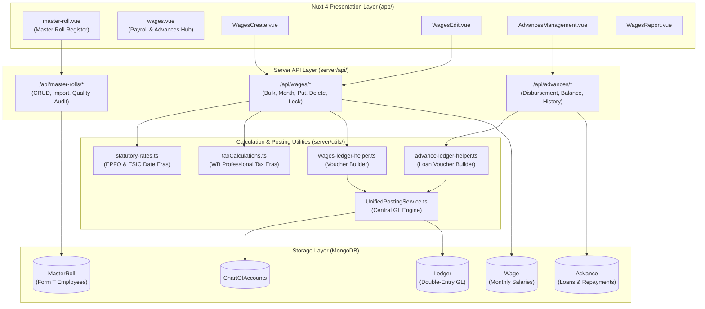
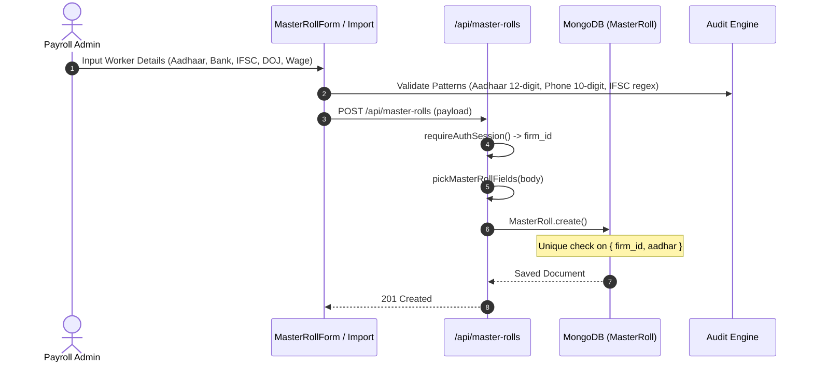
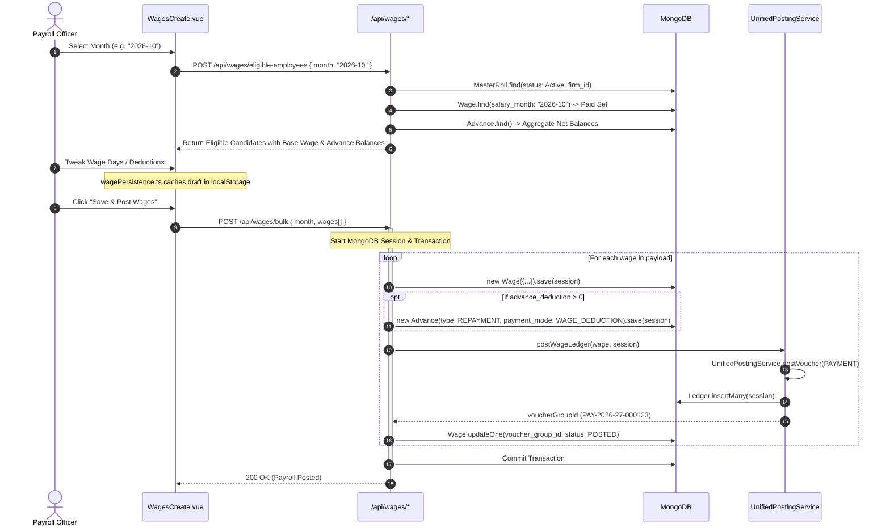
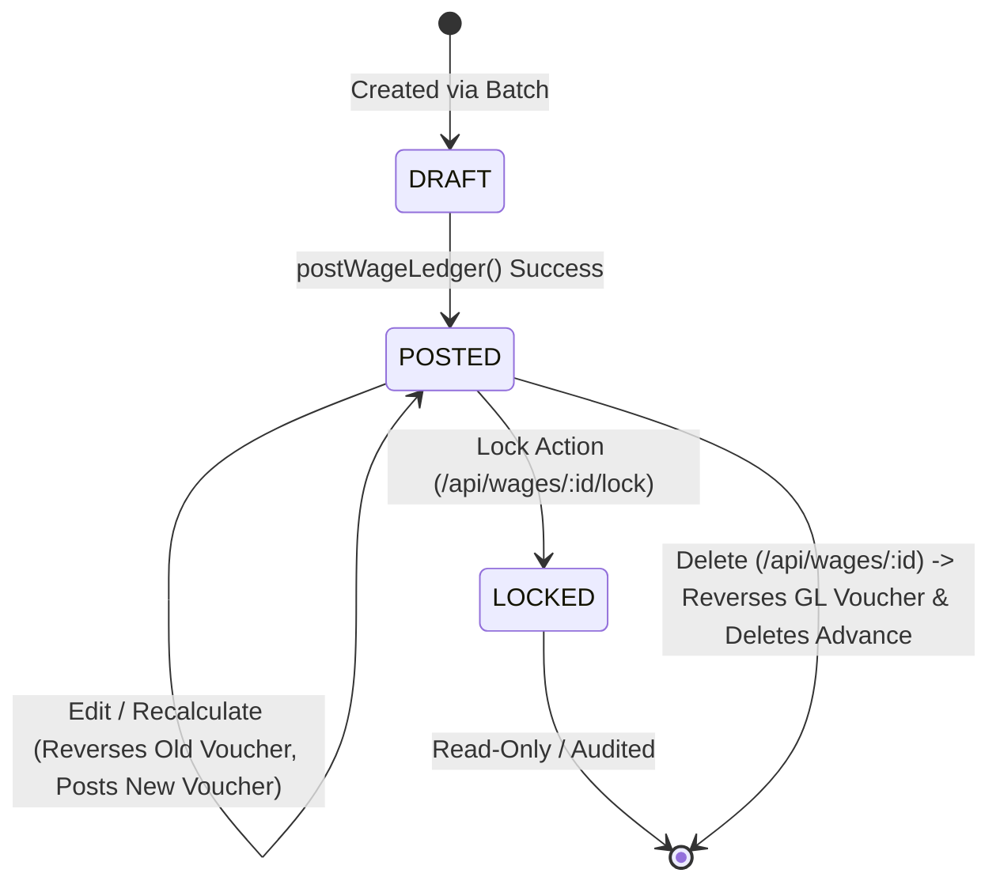
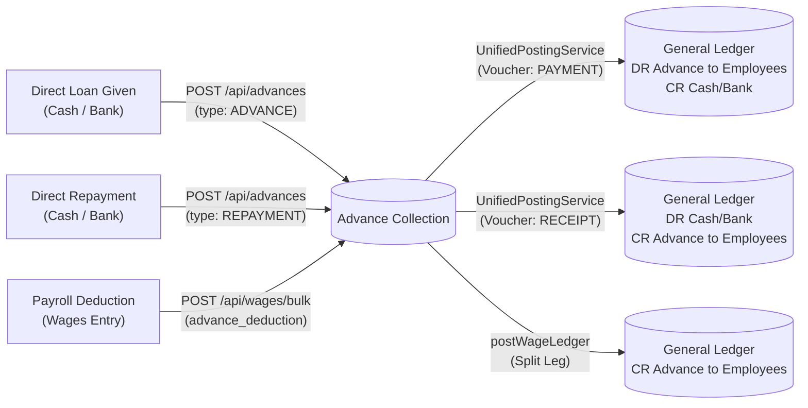
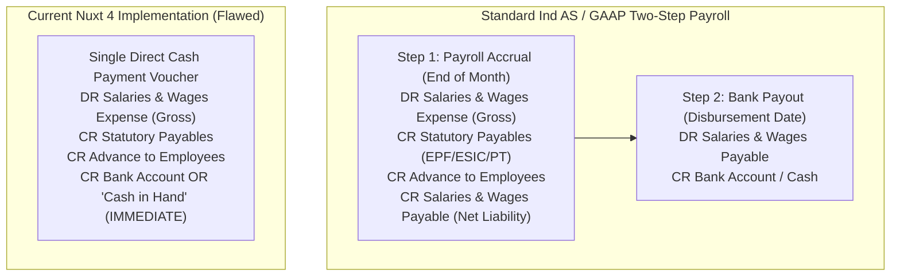
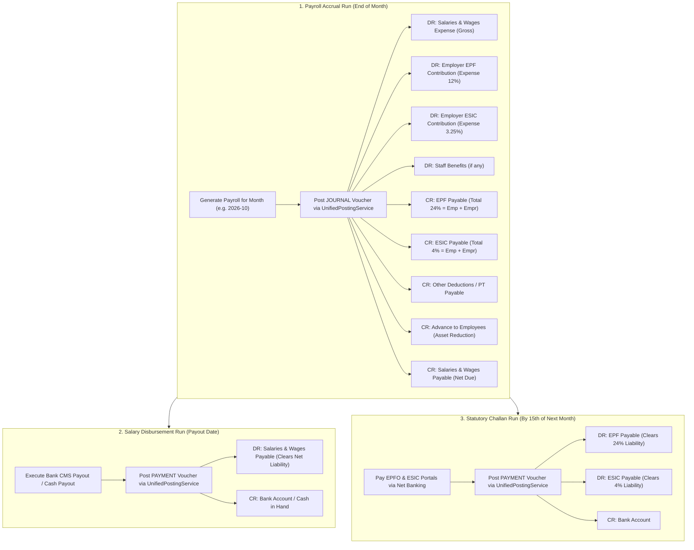

# Comprehensive Deep-Level Audit Report: Master Roll, Wages (Salary) System & Centralized Accounting Integration

**Document Version:** 2.0.0 (Deep Codebase Re-Audit Edition)  
**Audit Date:** November 5, 2026  
**Audited Subsystems:** Master Roll (HR / Form-A/Form-T Worker Register), Wages (Monthly Salary Engine), Staff Advances & Loan Sub-Ledger, Centralized General Ledger (`UnifiedPostingService`)  
**Target Platform:** `nuxt4` (Nuxt 4 Full-Stack Enterprise ERP)  
**File Location:** `docs/MASTER_ROLL_AND_WAGES_ACCOUNTING_AUDIT_REPORT.md`  

---

## Table of Contents
1. [Executive Summary & System Scorecard](#1-executive-summary--system-scorecard)
2. [Architectural Overview & Domain Concepts](#2-architectural-overview--domain-concepts)
   - 2.1 Dual Labor Architecture: MongoDB Master Roll vs PostgreSQL Gang Labor
   - 2.2 Domain Taxonomy: Master Roll (Form-A / Form-T) vs Muster Roll (Attendance)
   - 2.3 System Topology & Persistence Architecture
3. [Deep-Dive Workflow & Lifecycle Tracing](#3-deep-dive-workflow--lifecycle-tracing)
   - 3.1 Flow 1: Employee Master Roll Lifecycle (Onboarding, Auditing, Modification, Deletion)
   - 3.2 Flow 2: Wage & Payroll Generation Lifecycle (Eligibility, Calculation, Bulk Posting)
   - 3.3 Flow 3: Wage Recalculation, Editing, Locking, and Deletion Lifecycle
   - 3.4 Flow 4: Staff Advances & Repayment Sub-Ledger Lifecycle
   - 3.5 Flow 5: Statutory Reporting, Banking CMS, and Payout File Generation
4. [Mathematical Models & Statutory Calculation Logics](#4-mathematical-models--statutory-calculation-logics)
   - 4.1 Wage Component Formulations (Gross, Net, Per-Day Rate)
   - 4.2 EPFO Statutory Engine (Date-Aware Ceilings: Pre/Post 17-Sep-2026)
   - 4.3 ESIC Statutory Engine (Employee & Employer Computations)
   - 4.4 West Bengal Professional Tax (PT) Dual-Era Slabs (Gazette 1407-F.T. Revision)
   - 4.5 Advance Absorption & Deduction Constraints
   - 4.6 Double-Entry Mathematical Parity Proof
5. [Centralized Accounting Integration Deep Audit](#5-centralized-accounting-integration-deep-audit)
   - 5.1 The Cash-Basis Collapse Anti-Pattern (Omission of Accrual & Salaries Payable)
   - 5.2 The Missing Employer Statutory Liability in General Ledger (Negative Liability Math)
   - 5.3 Zero-Net-Salary Validation Crash
   - 5.4 Sub-Ledger Tag Stripping in `UnifiedPostingService`
   - 5.5 Reversal Voucher Churn on Wage Modification
   - 5.6 Sub-Ledger to General Ledger (SL-GL) Reconciliation Blind Spot
   - 5.7 Unsaved Cheque Numbers & Audit Trail Gaps in Advance Disbursements
6. [Defect, Vulnerability & Risk Matrix (15 Detailed Bugs)](#6-defect-vulnerability--risk-matrix-15-detailed-bugs)
7. [Target Architecture: Enterprise Payroll & Accrual Blueprint](#7-target-architecture-enterprise-payroll--accrual-blueprint)
   - 7.1 Separation of Accrual vs Disbursement (Two-Step Workflow)
   - 7.2 Complete Statutory Accounting Model
   - 7.3 Real-Time SL-GL Reconciler for Employee Advances
8. [Actionable Remediation Roadmap & Implementation Guide](#8-actionable-remediation-roadmap--implementation-guide)
   - Phase 1: Immediate Critical Bug Fixes (Sprint 1)
   - Phase 2: Accounting Schema & Accrual Engine Refactor (Sprint 2)
   - Phase 3: SL-GL Diagnostic & Reconciler Enhancement (Sprint 3)

---

## 1. Executive Summary & System Scorecard

A code-level re-audit was executed across the **Master Roll**, **Wages**, and **Staff Advances** modules in `nuxt4`, specifically evaluating their integration with the **Centralized Accounting System** (`UnifiedPostingService`, `Ledger`, `ChartOfAccounts`, and `BankAccount`).

Every endpoint, database model, composable, calculation helper, and accounting posting pipeline was cross-examined line by line.

The system features sophisticated date-aware statutory compliance (implementing the 17-Sep-2026 EPFO ceiling revision and 1-Oct-2026 West Bengal Professional Tax Gazette 1407-F.T. revision), gapless sequential voucher numbering, and optimistic concurrency guards. However, **critical accounting anti-patterns, data integrity omissions, and API routing mismatches** exist:

1. **The Cash-Basis Collapse Anti-Pattern (Financial Critical)**: The payroll engine collapses payroll accrual and payout into a single `PAYMENT` voucher. If wages are posted without a bank account or before disbursement, the system immediately credits `Cash in Hand` on today's date, bypassing `Salaries & Wages Payable` liability.
2. **Missing Employer Statutory Contributions in GL (Compliance Critical)**: Employer EPF (12%) and Employer ESIC (3.25%) are computed in statutory Excel reports but are **completely omitted from the General Ledger**. Paying government challans from the bank will drive liability accounts into severe negative debit balances.
3. **Zero-Net-Salary Posting Crash (Operational Blocker)**: If an employee's advances or statutory deductions equal their gross wage ($Net = 0$), the backend rejects the transaction with a validation error (`Net salary must be greater than 0`), preventing legitimate zero-payout settlements.
4. **Referential Cascade Failure on Employee Deletion (Data Integrity High)**: Deleting an employee via `DELETE /api/master-rolls/:id` leaves orphaned wages, advances, and ledger references. Orphaned advances become invisible in the UI balance report while the money remains trapped in the General Ledger asset account.
5. **Broken Composable Endpoints**: `useMasterRoll.ts` targets non-existent endpoints (`/api/master-rolls/bulk` for PUT and DELETE), causing bulk employee updates and deletes to fail with HTTP 400 (`Invalid employee id`).
6. **Advance Cheque Number Dropping**: Cheque numbers entered in `AdvanceFormModal.vue` are passed over the network but silently ignored by `server/api/advances.post.ts` and omitted from the `Advance` model schema.

### Subsystem Health Scorecard

| Domain | Architecture Grade | Correctness Grade | Audit Status | Key Vulnerability |
| :--- | :---: | :---: | :---: | :--- |
| **Master Roll Register** | **B+** | **C** | ⚠️ Needs Fixes | Broken bulk routes, cascade deletion leaves orphaned records |
| **Wage Calculation Logic** | **A-** | **B+** | 🟢 Good | Date-aware statutory eras intact; exit-date proration missing |
| **Staff Advance Sub-Ledger** | **B** | **C+** | ⚠️ Incomplete | No SL-GL reconciliation; deletion hides ghost balances; dropped cheque numbers |
| **Accounting Integration** | **C-** | **D** | 🔴 Severe Flaws | Direct cash credit instead of accrual; missing employer liabilities |
| **Audit Trails & Concurrency** | **A** | **A-** | 🟢 Solid | Optimistic concurrency (`__v`), gapless sequences, period locks |

---

## 2. Architectural Overview & Domain Concepts



### 2.1 Dual Labor Architecture: MongoDB Master Roll vs PostgreSQL Gang Labor

The codebase contains **two completely separate labor management architectures**:

1. **System 1: Master Roll & Wages System (MongoDB - Audited Here)**
   - **Target**: Permanent, monthly-rated, semi-permanent, and direct company laborers.
   - **Entities**: Individual employees (`MasterRoll`), monthly pay records (`Wage`), individual staff loans (`Advance`).
   - **Compliance**: Individual Aadhaar, UAN (EPFO), ESIC No, Form-T Central Labor Register, Individual Wage Slips (`.pdf`), Bank CMS Transfer sheets.
   - **Accounting**: Direct GL posting through `wages-ledger-helper.ts` and `advance-ledger-helper.ts`.

2. **System 2: Labor Gang & Sardar Muster System (PostgreSQL - Parallel Subsystem)**
   - **Target**: Daily-wage construction gang workers contracted under Sardars/Labor Leaders.
   - **Entities**: `labor_leaders`, `labor_periods`, `labor_workers`, `labor_advances`, `labor_settlements`.
   - **Compliance**: Gang attendance sheets, TDS deduction u/s 194C (Subcontractor/Labor Contractor).
   - **Accounting**: Periodic batch settlement via `labor-ledger-helper.ts` (Journal voucher crediting leader liability and debiting Labor Expenses).

> [!IMPORTANT]
> This audit focuses on **System 1 (Master Roll & Wages)** and its interface with the Centralized Accounting System (`UnifiedPostingService`).

### 2.2 Domain Taxonomy: Master Roll (Form-A / Form-T) vs Muster Roll (Attendance)

In statutory Indian industrial and labor law:
- **Master Roll (Form A / Form T Register)**: The permanent master register of workers containing demographic, statutory, banking, and pay-scale details.
- **Muster Roll (Form D / Form XVI)**: The **daily attendance register** tracking in/out timestamps, days worked, overtime hours, weekly offs, and unpaid absences.

**Architectural Finding:**  
The subsystem titled "Master Roll" implements Form A/T employee master information. However, **there is no daily Muster Roll (Attendance Tracking) for Master Roll employees**. In `Wage.ts`, attendance is captured solely as a scalar number: `wage_days: Number` (defaulting to 26). Daily attendance logs exist *only* in the PostgreSQL labor module for gang workers.

### 2.3 System Topology & Persistence Architecture

```
├── app/
│   ├── components/
│   │   ├── master-roll/        # MasterRollForm, Import, BulkEdit, WagesSummaryModal
│   │   └── wages/              # WagesCreate, WagesEdit, WagesDashboard, AdvancesManagement, WagesReport
│   ├── composables/
│   │   ├── useMasterRoll.ts    # Client API communications for employee master
│   │   ├── useWages.ts         # Client API communications for wages & payroll
│   │   └── useAdvances.ts      # Client API communications for employee advances
│   └── utils/
│       ├── masterRollAudit.ts  # Client-side data quality audit engine
│       ├── wagePersistence.ts  # LocalStorage resilience engine for drafting wages
│       └── taxCalculations.ts  # Professional tax dual-era slab calculators
├── server/
│   ├── api/
│   │   ├── master-rolls/       # CRUD, import, export, stats, bulk-update
│   │   ├── wages/              # bulk, month, put, delete, lock, bank-report, epf-esic
│   │   └── advances/           # balances, balance/:id, history/:id, delete
│   ├── models/
│   │   ├── MasterRoll.ts       # Employee schema (compound unique index: firm_id + aadhar)
│   │   ├── Wage.ts             # Wage schema (compound unique: firm_id + master_roll_id + salary_month)
│   │   ├── Advance.ts          # Advance schema (ADVANCE / REPAYMENT)
│   │   ├── WageJob.ts          # Background job schema (currently bypassed/dead code)
│   │   └── Ledger.ts           # Central double-entry General Ledger schema
│   └── utils/
│       ├── wages-ledger-helper.ts   # Resolves accounts and builds wage voucher legs
│       ├── advance-ledger-helper.ts # Builds advance disbursement/recovery legs
│       └── accounting/
│           ├── unified-posting.service.ts # Central transactional GL poster
│           └── sl-gl-reconciler.service.ts # Sub-ledger vs GL balance auditor
└── shared/
    └── utils/
        └── statutory-rates.ts  # Date-aware EPFO and ESIC configuration eras
```

---

## 3. Deep-Dive Workflow & Lifecycle Tracing

### 3.1 Flow 1: Employee Master Roll Lifecycle



#### Lifecycle Steps & Critical Findings:
1. **Creation (`POST /api/master-rolls.post.ts`)**:
   - Enforces required fields: `employee_name`, `father_husband_name`, `date_of_birth`, `aadhar`, `phone_no`, `address`, `bank`, `account_no`, `ifsc`, `date_of_joining`.
   - Protects tenancy by injecting `firm_id: user.firm_id`.
   - Index enforcement: Compound unique index `{ firm_id: 1, aadhar: 1 }` prevents duplicate Aadhaar registrations within the same firm.
   - *Omission*: Does not validate format regex (Aadhaar 12-digits, Phone 10-digits, IFSC code) or statutory age ($< 18$) at the API boundary; validations exist only in the read-only audit engine.
2. **Bulk Excel Import (`POST /api/master-rolls/import.post.ts`)**:
   - Iterates through raw rows, executing `MasterRoll.create()`.
   - Collects per-row errors (`imported`, `failed`, `errors[]`).
   - Does not use MongoDB batch operations (`insertMany` with `ordered: false`), executing $N$ round-trips for $N$ employees.
3. **Bulk Modification (`server/api/master-rolls/bulk-update.put.ts`)**:
   - Updates multiple employee fields via `findOneAndUpdate` using `runValidators: true`.
   - *Critical Route Mismatch*: The client composable `useMasterRoll.ts` (line 96) calls `PUT /api/master-rolls/bulk`. Nuxt 4 route resolution maps this to `server/api/master-rolls/[id].put.ts` with `id="bulk"`. Because `"bulk"` is not a 24-character ObjectId, it throws `400: Invalid employee id`.
4. **Employee Deletion (`server/api/master-rolls/[id].delete.ts`)**:
   - Executes `MasterRoll.findOneAndDelete({ _id: id, firm_id })`.
   - *Critical Cascade Failure*: There is **zero check** for existing `Wage` documents, `Advance` records, or `Ledger` entries. Deleting an employee leaves orphaned historical payroll data and makes outstanding advances invisible in the advance register.

---

### 3.2 Flow 2: Wage & Payroll Generation Lifecycle



#### Lifecycle Steps & Critical Findings:
1. **Eligibility Filtering (`/api/wages/eligible-employees.post.ts`)**:
   - Filters active employees where `date_of_joining <= monthEnd` and (`!date_of_exit || date_of_exit >= monthStart`).
   - Excludes workers who already have a `Wage` document in `salary_month`.
   - Pre-loads historical `last_wage_days` and `last_p_day_wage` from their most recent pay slip.
   - Computes live `advance_balance` from the `Advance` collection.
   - *Tenure Defect*: Workers joining or exiting mid-month are defaulted to 26 wage days without proration or warnings.
2. **Draft Persistence (`app/utils/wagePersistence.ts`)**:
   - Saves state to `localStorage` keyed by `firmId` and `month`.
   - Performs reconciliation on load: reconciles cached modifications with the server's unpaid candidate list.
3. **Synchronous Execution (`/api/wages/bulk.post.ts`)**:
   - Executes inside a single MongoDB ClientSession transaction.
   - Iterates through the wages array:
     * Validates $wage\_days > 0$.
     * Calculates $net\_salary$.
     * Saves `Wage` document with `status: 'POSTED'`.
     * If $advance\_deduction > 0$, creates an `Advance` repayment record with `wage_id`.
     * Calls `postWageLedger` which invokes `UnifiedPostingService.postVoucher`.
     * Commits transaction.
   - *Dead Code*: `wage-job-processor.ts` contains background job handling code that is completely orphaned because `bulk.post.ts` switched to inline processing.

---

### 3.3 Flow 3: Wage Recalculation, Editing, Locking, and Deletion Lifecycle



#### Lifecycle Steps & Critical Findings:
1. **Single Wage Modification (`PUT /api/wages/[id].put.ts`)**:
   - Guarded by `requireWageRole(['Owner', 'Admin', 'Manager'])`.
   - Verifies `wage.status !== 'LOCKED'`.
   - Filters client inputs through `EDITABLE_FIELDS` allowlist.
   - **Step A**: Reverses existing GL voucher via `deleteWageLedger` -> `UnifiedPostingService.reverseVoucher`.
   - **Step B**: Deletes existing advance repayment records tied to `wage._id`.
   - **Step C**: Applies modifications and recalculates gross, net, and per-day rate.
   - **Step D**: Reposts new voucher via `postWageLedger`.
   - **Step E**: Re-creates advance repayment record.
   - *Concurrency Guard*: Uses Mongoose `optimisticConcurrency: true` (`__v` version check) to throw a `VersionError` if another admin edited the record simultaneously.
2. **Single Wage Deletion (`DELETE /api/wages/[id].delete.ts`)**:
   - Reverses GL voucher entries.
   - Deletes all `Advance` records where `wage_id === id`.
   - Deletes `Wage` document.
3. **Wage Locking (`POST /api/wages/[id]/lock.post.ts`)**:
   - Enforces state machine: only `POSTED` wages can transition to `LOCKED`.
   - Once locked, `[id].put.ts` and `[id].delete.ts` reject all modifications with `403: Wage is locked`.

---

### 3.4 Flow 4: Staff Advances & Repayment Sub-Ledger Lifecycle

The staff advance sub-ledger tracks loans granted to staff and their recoveries:



#### Sub-Ledger Accounting Rules:
- **Outstanding Balance Calculation**:
  $$\text{Balance} = \sum (\text{Type} == \text{'ADVANCE'} \times \text{Amount}) - \sum (\text{Type} == \text{'REPAYMENT'} \times \text{Amount})$$
- **Disbursement Entry (PAYMENT Voucher)**:
  - **Debit**: `Advance to Employees` (ASSET)
  - **Credit**: `Bank Account` or `Cash in Hand`
- **Direct Repayment Entry (RECEIPT Voucher)**:
  - **Debit**: `Bank Account` or `Cash in Hand`
  - **Credit**: `Advance to Employees` (ASSET)
- **Payroll Deduction Entry (Part of Wage Voucher)**:
  - **Credit**: `Advance to Employees` (ASSET)

---

### 3.5 Flow 5: Statutory Reporting, Banking CMS, and Payout File Generation

The system includes three export engines:

1. **Bank CMS Transfer Report (`/api/wages/bank-report.get.ts`)**:
   - Generates Excel formatted for corporate banking CMS bulk uploads.
   - Header metadata includes Cheque No / Reference No and Cheque Date.
   - 10-column schema: Paysys ID (`RTGS`/`NEFT`), Debit Account, Transfer Amount, Beneficiary Account, Beneficiary Account Type, Beneficiary Name, Beneficiary Addresses, IFSC Code.
   - Excludes cash payments automatically.
2. **EPFO & ESIC Compliance Report (`/api/wages/epf-esic-report.get.ts`)**:
   - Generates complete monthly statutory schedule for labor department compliance.
   - Reports Employee Share: EPF (12%), ESIC (0.75%).
   - Reports Employer Share: EPF (12%), ESIC (3.25%).
   - Displays Grand Total Contribution per worker.
   - Includes cross-period exit reconciliation: identifies workers who exited in the preceding month to account for statutory attrition.
3. **BulkWage Slips Generator (`/api/wages/bulk-slips.get.ts`)**:
   - Renders individual formatted PDF wage slips using `pdfkit`.
   - Streams documents into a single in-memory ZIP archive using `archiver`.

---

## 4. Mathematical Models & Statutory Calculation Logics

### 4.1 Wage Component Formulations

The core wage equations are evaluated both in the client (`WagesCreate.vue`, `WagesEdit.vue`) and server services:

1. **Gross Salary Formula**:
   $$\text{Gross Salary} = \text{round}\left(\text{p\_day\_wage} \times \text{wage\_days},\ 2\right)$$
   Where:
   - $\text{p\_day\_wage}$: Daily wage rate in INR (stored on `MasterRoll`).
   - $\text{wage\_days}$: Actual man-days worked in the calendar month (defaults to 26).

2. **Per-Day Wage Back-Calculation** (when editing gross directly):
   $$\text{p\_day\_wage} = \begin{cases} \text{round}\left(\frac{\text{Gross Salary}}{\text{wage\_days}},\ 2\right) & \text{if } \text{wage\_days} > 0 \\ 0 & \text{otherwise} \end{cases}$$

3. **Net Take-Home Salary Formula**:
   $$\text{Total Deductions} = \text{EPF} + \text{ESIC} + \text{Other Deductions (PT)} + \text{Advance Deduction}$$
   $$\text{Net Salary} = \text{Gross Salary} - \text{Total Deductions} + \text{Other Benefits}$$

---

### 4.2 EPFO Statutory Engine (Date-Aware Ceilings: Pre/Post 17-Sep-2026)

Located in `shared/utils/statutory-rates.ts`, the system implements a date-aware era architecture responding to the Union Cabinet notification regarding the EPF wage ceiling revision:

```typescript
export interface StatutoryEra {
  effectiveFrom: string;     // YYYY-MM-DD
  epfCeiling: number;        // Monthly wage ceiling
  maxEpfDeduction: number;   // ceiling * 0.12
  epfRate: number;           // 0.12 (12%)
  esicEmployeeRate: number;  // 0.0075 (0.75%)
  esicEmployerRate: number;  // 0.0325 (3.25%)
}

const STATUTORY_ERAS: ReadonlyArray<StatutoryEra> = [
  {
    effectiveFrom: '2026-09-17',
    epfCeiling: 25_000,
    maxEpfDeduction: 3_000,   // 25,000 * 12%
    epfRate: 0.12,
    esicEmployeeRate: 0.0075,
    esicEmployerRate: 0.0325,
  },
  {
    effectiveFrom: '1952-01-01',
    epfCeiling: 15_000,
    maxEpfDeduction: 1_800,   // 15,000 * 12%
    epfRate: 0.12,
    esicEmployeeRate: 0.0075,
    esicEmployerRate: 0.0325,
  },
];
```

#### Mathematical Deduction Formula:
$$\text{EPF Deduction} = \min\left(\text{round}(\text{Gross Salary} \times 0.12),\ \text{maxEpfDeduction}\right)$$

- **For payroll months prior to 2026-09**:
  $$\text{Max EPF} = ₹1,800 \quad (\text{Wages capped at } ₹15,000)$$
- **For payroll months from 2026-09 onwards**:
  $$\text{Max EPF} = ₹3,000 \quad (\text{Wages capped at } ₹25,000)$$
- **Exit Date Exception**: If an employee has `date_of_exit < 2026-09-17`, the resolver automatically falls back to the prior era (ceiling of ₹15,000), preventing statutory over-deduction for workers who left service before the effective date.

---

### 4.3 ESIC Statutory Engine

Under the Employees' State Insurance Act:
- **Employee Contribution Rate**: $0.75\%$ ($0.0075$) of Gross Salary.
- **Employer Contribution Rate**: $3.25\%$ ($0.0325$) of Gross Salary.
- **Rounding Rule**: Statutory rounding dictates rounding up to the next rupee:
  $$\text{ESIC}_{\text{Employee}} = \lceil \text{Gross Salary} \times 0.0075 \rceil$$
  $$\text{ESIC}_{\text{Employer}} = \lceil \text{Gross Salary} \times 0.0325 \rceil$$

---

### 4.4 West Bengal Professional Tax (PT) Dual-Era Slabs

Located in `app/utils/taxCalculations.ts`, the system implements a dual-era slab calculator representing both the historical schedule and the Gazette Notification No. 1407-F.T. revision effective 1-Oct-2026:

#### Era 1: Effective from 1-Oct-2026 onwards (Gazette Notification 1407-F.T.):
$$\text{PT Deduction} = \begin{cases} 
₹0 & \text{if } \text{Gross} \le 20,000 \\
₹100 & \text{if } 20,001 \le \text{Gross} \le 30,000 \\
₹140 & \text{if } 30,001 \le \text{Gross} \le 50,000 \\
₹170 & \text{if } 50,001 \le \text{Gross} \le 1,00,000 \\
₹208 & \text{if } \text{Gross} > 1,00,000 
\end{cases}$$

#### Era 2: Historical Fallback (Pre-October 2026):
$$\text{PT Deduction} = \begin{cases} 
₹0 & \text{if } \text{Gross} \le 10,000 \\
₹110 & \text{if } 10,001 \le \text{Gross} \le 15,000 \\
₹130 & \text{if } 15,001 \le \text{Gross} \le 25,000 \\
₹150 & \text{if } 25,001 \le \text{Gross} \le 40,000 \\
₹200 & \text{if } \text{Gross} > 40,000 
\end{cases}$$

---

### 4.5 Advance Absorption & Deduction Constraints

To prevent negative payouts or recovery beyond actual indebtedness:
1. **Total Deductions Upper Bound**:
   $$\text{Total Deductions} \le \text{Gross Salary}$$
2. **Advance Deduction Upper Bound**:
   $$\text{Advance Deduction} \le \text{Outstanding Employee Advance Balance}$$

---

### 4.6 Double-Entry Mathematical Parity Proof

When `postWageLedger` constructs the voucher legs, double-entry equality ($\sum \text{Debit} \equiv \sum \text{Credit}$) must hold strictly:

$$\begin{aligned}
\sum \text{Debit} &= \text{Gross Salary (Salaries \& Wages)} + \text{Other Benefit (Staff Benefits)} \\
\sum \text{Credit} &= \text{Net Salary (Cash / Bank)} + \text{EPF Deduction (EPF Payable)} \\
&\quad + \text{ESIC Deduction (ESIC Payable)} + \text{Other Deduction (Other Deductions)} \\
&\quad + \text{Advance Deduction (Advance to Employees)}
\end{aligned}$$

Substituting the formula for $\text{Net Salary}$:
$$\begin{aligned}
\sum \text{Credit} &= \left[\text{Gross} - (\text{EPF} + \text{ESIC} + \text{OtherDed} + \text{AdvDed}) + \text{OtherBenefit}\right] \\
&\quad + \text{EPF} + \text{ESIC} + \text{OtherDed} + \text{AdvDed} \\
&= \text{Gross Salary} + \text{Other Benefit} \\
&= \sum \text{Debit}
\end{aligned}$$

The mathematical equality is exact. However, as demonstrated in Section 5, severe accounting defects exist in *how* these accounts are classified and timed.

---

## 5. Centralized Accounting Integration Deep Audit

The interface between the Wages module and the General Ledger occurs in `server/utils/wages-ledger-helper.ts` via `UnifiedPostingService.postVoucher()`. A rigorous financial analysis revealed several systemic flaws.

### 5.1 The Cash-Basis Collapse Anti-Pattern

In standard commercial and enterprise accounting (GAAP, Ind AS 19, IFRS), **Payroll is an Accrual Event**, distinct from **Disbursement**:



#### What Current Code Does (`server/utils/wages-ledger-helper.ts` lines 219-241):
```typescript
let bankAccount;
if (wage.paid_date && wage.bank_account_id) {
  bankAccount = await resolveBankAccount(firmId, wage.bank_account_id, userId, session);
} else {
  // FLUID COLLAPSE: Defaults to Cash in Hand immediately!
  bankAccount = await getDefaultCashAccount(firmId, userId, session);
}

entries.push({
  firmId: firmId,
  accountHead: bankAccount.account_name,
  accountType: bankAccount.account_type,
  debitAmount: 0,
  creditAmount: wage.net_salary,
  // ...
});

await UnifiedPostingService.postVoucher({
  firmId,
  voucherType: 'PAYMENT', // Hardcoded as a PAYMENT voucher
  transactionDate,
  legs,
  // ...
});
```

#### Financial Consequences:
1. **Unpaid Wages Artificially Deplete Cash**: If a firm generates payroll on October 31 but does not disburse payments until November 7, the system immediately credits `Cash in Hand` on October 31! The Balance Sheet reports cash that does not exist in the vault, while total liabilities are understated.
2. **Missing `Salaries & Wages Payable` Liability**: There is **no account head** for `Salaries Payable` or `Wages Payable` anywhere in the codebase.
3. **No Payout Settlement Workflow**: There is no mechanism to mark an accrued salary as "Paid" at a later date against a bank statement.

---

### 5.2 The Missing Employer Statutory Liability in General Ledger

A massive compliance and bookkeeping distortion exists regarding employer statutory contributions.

- In `server/api/wages/epf-esic-report.get.ts`, the report accurately calculates:
  - Employer EPF: $12\%$ of eligible wages
  - Employer ESIC: $3.25\%$ of gross wages
- **However, in `server/utils/wages-ledger-helper.ts`, NEITHER of these is posted to the General Ledger!**

#### The Flawed GL Ledger Posting:
```
Debit:  Salaries & Wages Expense (Gross)       ₹100,000
Credit: EPF Payable (Employee 12% only)         ₹12,000
Credit: ESIC Payable (Employee 0.75% only)         ₹750
Credit: Bank Account (Net Salary Paid)          ₹87,250
```

#### What Actually Happens When Paying the Government Challan:
When the accounts team files the monthly ECR on the EPFO unified portal, the required challan payment is:
- Employee Share: $12\%$ ($₹12,000$)
- Employer Share: $12\%$ ($₹12,000$) + Admin/EDLI charges ($₹1,000$)
- **Total Paid from Bank**: **$₹25,000$**

When the accountant enters the bank payment in Daybook:
- Debit: `EPF Payable` $₹25,000$
- Credit: `Bank Account` $₹25,000$

**Resulting Balance in `EPF Payable`:**
$$\text{Opening Balance} = ₹12,000 \text{ (Cr)}$$
$$\text{Challan Payment} = ₹25,000 \text{ (Dr)}$$
$$\textbf{Closing Balance} = \mathbf{₹13,000 \text{ (DEBIT / NEGATIVE LIABILITY!)}}$$

The General Ledger reflects a negative liability (as if EPFO owes the firm money), because the Employer's matching contribution was **never recognized as an expense or accrued as a liability**.

---

### 5.3 Zero-Net-Salary Validation Crash

In `server/utils/wages-ledger-helper.ts` (lines 20-22):
```typescript
if (!wage.net_salary || wage.net_salary <= 0) {
  errors.push('Net salary must be greater than 0');
}
```

#### The Problem:
It is common for workers to take advance wages such that their monthly recovery equals their net earnings ($Net = ₹0$). Under current logic:
1. `validateWageForPosting` throws an exception: `"Net salary must be greater than 0"`.
2. Even if that check were bypassed, line 231 would push a ledger leg with `creditAmount: 0` to Bank/Cash.
3. In `validateLedgerEntries` (and `UnifiedPostingService` double-entry rules):
   ```typescript
   if ((entry.debitAmount || 0) === 0 && (entry.creditAmount || 0) === 0) {
     errors.push(`Zero-amount entry for ${entry.accountHead}`);
   }
   ```
   The voucher is rejected because zero-value legs are prohibited.
4. **Impact**: An employee whose advance covers their entire paycheck cannot be processed in payroll.

---

### 5.4 Sub-Ledger Tag Stripping in `UnifiedPostingService`

In `server/models/Ledger.ts`, the schema explicitly defines:
```typescript
isWageEntry:  { type: Boolean, default: false },
masterRollId: { type: Schema.Types.ObjectId, ref: 'MasterRoll', default: null }
```

In `server/utils/wages-ledger-helper.ts` (lines 335-336):
```typescript
await UnifiedPostingService.postVoucher({
  firmId,
  // ...
  tags: { masterRollId: wage.master_roll_id, salaryMonth: wage.salary_month },
}, session);
```

#### The Bug:
In `server/utils/accounting/unified-posting.service.ts` (lines 106-125), `postVoucher` maps incoming legs to ledger documents:
```typescript
const ledgerDocs = resolvedLegs.map((leg) => ({
  firmId: firmIdObj,
  transactionDate: payload.transactionDate,
  accountHead: leg.accountHead,
  accountType: leg.accountType,
  debitAmount: leg.debitAmount || 0,
  creditAmount: leg.creditAmount || 0,
  narration: leg.narration || payload.narration,
  voucherGroupId,
  voucherNo,
  voucherType: payload.voucherType,
  refType: payload.refType || 'VOUCHER',
  refId: payload.refId ? this.toObjectIdSafe(payload.refId) : null,
  partyId: leg.partyId ? this.toObjectIdSafe(leg.partyId) : null,
  bankAccountId: leg.bankAccountId ? this.toObjectIdSafe(leg.bankAccountId) : null,
  stockId: leg.stockId ? this.toObjectIdSafe(leg.stockId) : null,
  stockRegId: leg.stockRegId ? this.toObjectIdSafe(leg.stockRegId) : null,
  paymentMode: leg.paymentMode || null,
  createdBy: payload.createdBy,
  // isWageEntry and masterRollId ARE NEVER MAPPED!
}));
```
`postVoucher` completely ignores `payload.tags` and never populates `isWageEntry` or `masterRollId`.
**Impact**: Every wage entry in `Ledger` has `isWageEntry: false` and `masterRollId: null`. Reconciling or filtering GL entries by employee ID is impossible.

---

### 5.5 Reversal Voucher Churn on Wage Modification

In `server/api/wages/[id].put.ts`:
Whenever a wage is updated, the system executes:
```typescript
await deleteWageLedger(wage._id, user.firm_id, session);
// ...
const voucherId = await postWageLedger(wage, session);
```

Inside `deleteWageLedger`:
```typescript
await UnifiedPostingService.reverseVoucher({
  originalVoucherGroupId: vGroupId,
  firmId,
  reason: 'Wage record deleted/cancelled',
  createdBy: 'system',
  session
});
```

`reverseVoucher` creates a brand-new `PAYMENT` voucher with swapped Debits and Credits, consuming a sequence number (e.g. `PAY-2026-27-000456`). Then `postWageLedger` creates *another* voucher (`PAY-2026-27-000457`).

If an administrator adjusts 20 wage records for minor errors, **40 new vouchers** are injected into the General Ledger. `UnifiedPostingService` contains a specialized `updateVoucher()` method designed for atomic leg replacement without sequence number consumption, but the Wages module does not utilize it.

---

### 5.6 Sub-Ledger to General Ledger (SL-GL) Reconciliation Blind Spot

In `server/api/accounting/audit/sl-gl-reconcile.get.ts`, the system runs diagnostics via `SLGLReconcilerService`.
It audits:
- Accounts Receivable (Party Sub-ledger vs GL Sundry Debtors)
- Accounts Payable (Party Sub-ledger vs GL Sundry Creditors)
- Bank Registers (BankAccount models vs GL Bank accounts)
- Labor Leaders (PostgreSQL Labor Leaders vs GL Labor Leader accounts)

**Omission**: There is **no reconciliation routine for Employee Advances**.
The system cannot detect if:
- Total outstanding balance in `Advance` collection matches the General Ledger balance of `Advance to Employees` (Asset).
- Deletions or unlinked entries cause sub-ledger to drift from GL.

---

### 5.7 Unsaved Cheque Numbers & Audit Trail Gaps in Advance Disbursements

In `app/components/wages/AdvanceFormModal.vue` and `app/composables/useAdvances.ts` (lines 56-59):
- The user enters `cheque_no` when recording a bank advance payment.
- `useAdvances.ts` packages `{ chequeNo: data.cheque_no }` into the HTTP request body.
- However, in `server/api/advances.post.ts`:
  ```typescript
  const { masterRollId, amount, date, paymentMode, remarks, bankAccountId, type } = body;
  // chequeNo is completely dropped and never extracted!
  ```
- Furthermore, `server/models/Advance.ts` has **no `cheque_no` field** in its Mongoose schema!
- And in `server/utils/advance-ledger-helper.ts`:
  ```typescript
  await UnifiedPostingService.postVoucher({
    // referenceNo is omitted!
  });
  ```
- **Impact**: When the firm disburses ₹50,000 as an advance via Cheque #123456, the cheque number is never recorded in the Advance document or the General Ledger. Bank reconciliation against bank statements becomes completely manual and disconnected.

---

## 6. Defect, Vulnerability & Risk Matrix (15 Detailed Bugs)

| Ref # | Severity | Category | Affected File(s) & Line(s) | Description | Impact |
| :--- | :---: | :---: | :--- | :--- | :--- |
| **BUG-01** | **CRITICAL** | Accounting Logic | `server/utils/wages-ledger-helper.ts` (L219-241) | **Cash-Basis Collapse**: Credits `Cash in Hand` on payroll date even if unpaid. No `Wages Payable` accrual. | Balance sheet cash understated; unpaid liabilities omitted. |
| **BUG-02** | **CRITICAL** | Statutory / GL | `server/utils/wages-ledger-helper.ts` (L185-315) | **Omission of Employer Statutory Contributions**: Employer EPF (12%) and ESIC (3.25%) not posted to GL. | `EPF Payable` and `ESIC Payable` run into massive negative liability balances upon challan payment. |
| **BUG-03** | **HIGH** | Payroll Logic | `server/utils/wages-ledger-helper.ts` (L20-22) | **Zero-Net-Salary Rejection**: Rejects wages where deductions equal gross ($Net = 0$). | Employees with full advance recovery cannot be processed in payroll. |
| **BUG-04** | **HIGH** | API / Routing | `app/composables/useMasterRoll.ts` (L87, L96) | **Broken Bulk Routes**: Calls `/api/master-rolls/bulk` (PUT/DELETE) instead of `/bulk-update`. | Bulk employee updates and bulk deletes fail with HTTP 400. |
| **BUG-05** | **HIGH** | Data Integrity | `server/api/master-rolls/[id].delete.ts` (L16-19) | **Cascading Delete Failure**: Deleting employee leaves orphaned `Wage` and `Advance` records. | Orphaned advances disappear from reports but remain trapped in GL. |
| **BUG-06** | **HIGH** | Sub-Ledger | `server/api/wages/bulk.post.ts` (L70-83) | **Unchecked Advance Deduction**: Does not validate if deduction exceeds employee's advance balance. | Creates negative loan balances (employee owes negative money). |
| **BUG-07** | **MEDIUM** | GL Audit Trail | `server/utils/accounting/unified-posting.service.ts` (L106-125) | **Dropped Sub-Ledger Tags**: `isWageEntry` and `masterRollId` never mapped into `Ledger` documents. | Inability to audit or filter GL rows by employee. |
| **BUG-08** | **MEDIUM** | Sub-Ledger | `server/api/advances.post.ts` & `Advance.ts` | **Dropped Advance Cheque Number**: Cheque number sent from UI is discarded by API and missing from schema. | Bank reconciliation cannot match advance payments to bank cheques. |
| **BUG-09** | **MEDIUM** | UI / UX | `app/components/wages/AdvanceHistoryModal.vue` (L77) | **Broken Wage Deduction Delete Button**: History modal displays active delete button on wage deductions, throwing 500 error. | User confusion when trying to delete wage deductions from modal. |
| **BUG-10** | **MEDIUM** | Payroll Logic | `server/api/wages/eligible-employees.post.ts` (L120-137) | **Unprorated Mid-Month Wage Days**: Employees joining/exiting mid-month default to 26 wage days without warning. | Overpayment risk if payroll officer fails to manually adjust days. |
| **BUG-11** | **MEDIUM** | Validation Gap | `server/api/master-rolls.post.ts` & `import.post.ts` | **Missing Entry Validation**: Audit checks (age < 18, regex patterns) exist only in read-only reports, not on write. | Corrupt records (underage workers, invalid IFSC) can be saved freely. |
| **BUG-12** | **MEDIUM** | Reporting | `server/api/wages/bulk-slips.get.ts` (L155-160) | **Duplicate Filenames in Bulk ZIP**: Zip entry named `WageSlip_${safeName}_${month}.pdf`. | Workers with identical names overwrite each other in download. |
| **BUG-13** | **LOW** | Performance | `server/utils/wage-job-processor.ts` & `bulk.post.ts` | **Dead Code & Batch Transaction Fragility**: `bulk.post.ts` runs all in 1 transaction; failure in 1 worker rolls back 50. | Entire payroll run fails if a single employee has an invalid account. |
| **BUG-14** | **LOW** | SL-GL Audit | `server/utils/accounting/sl-gl-reconciler.service.ts` | **Omission of Advances in SL-GL Audit**: SL-GL reconciler checks AR, AP, and Banks, but ignores Employee Advances. | Loan balance drift between sub-ledger and GL is undetectable. |
| **BUG-15** | **LOW** | Schema | `server/models/Ledger.ts` & `wages-ledger-helper.ts` (L367) | **Unindexed / Unschema'd `isReversed`**: `updateMany` sets `isReversed: true` which is not in `Ledger` schema. | Mongoose strict mode drops the field; dead update. |
| **BUG-16** | **CRITICAL** | Data Mutation / Temporal Drift | `server/api/wages/bulk.post.ts` & `MasterRoll` | **Missing Wage Site Snapshotting & Lack of Site Movement Tracking**: `bulk.post.ts` omitted `project` and `site` on `Wage`. Reports dynamically fell back to live `MasterRoll.site`. Moving an employee retroactively mutated past payroll reports. No movement audit history existed. | Historical payroll reports corrupted upon employee transfer. Non-compliance with Contract Labour Act (Form XIII establishment registers). |

---

## 7. Target Architecture: Enterprise Payroll & Accrual Blueprint

To elevate this subsystem to enterprise-grade compliance, the following target architecture is specified:



### 7.1 Separation of Accrual vs Disbursement (Two-Step Workflow)

1. **Step 1: Payroll Accrual (JOURNAL Voucher)**
   - Generated on the last day of the salary month.
   - Accrues all expenses and liabilities.
   - Net pay is credited to `Salaries & Wages Payable` (Liability).
   - If Net Salary is $0$, the journal entry remains perfectly balanced because no leg is created for `Salaries Payable`.
2. **Step 2: Salary Disbursement (PAYMENT Voucher)**
   - Executed on the actual payout date.
   - Can be executed in batches (e.g. Bank CMS batch vs Cash batch).
   - Debits `Salaries & Wages Payable` and credits `Bank Account` or `Cash in Hand`.
   - Leaves a clear audit trail matching bank statements during bank reconciliation.

---

### 7.2 Complete Statutory Accounting Model

Under this blueprint, `wages-ledger-helper.ts` resolves:
1. `Salaries & Wages`: EXPENSE (Gross)
2. `Employer EPF Contribution`: EXPENSE (12% up to ceiling)
3. `Employer ESIC Contribution`: EXPENSE (3.25% of gross)
4. `EPF Payable`: PAYABLE (Combined 24% employee + employer)
5. `ESIC Payable`: PAYABLE (Combined 4% employee + employer)
6. `Professional Tax Payable`: PAYABLE (Slab amount)
7. `Advance to Employees`: ASSET (Repayment credit)
8. `Salaries & Wages Payable`: PAYABLE (Net payable)

This guarantees that GL liabilities precisely equal government challan amounts.

---

### 7.3 Real-Time SL-GL Reconciler for Employee Advances

Extend `SLGLReconcilerService` (`server/utils/accounting/sl-gl-reconciler.service.ts`) with a dedicated sub-ledger auditor:

```typescript
private static async reconcileEmployeeAdvances(
  firmId: mongoose.Types.ObjectId,
  toDate: string
) {
  // 1. General Ledger Balance: 'Advance to Employees' (ASSET)
  const glDoc = await Ledger.aggregate([
    {
      $match: {
        firmId,
        accountHead: 'Advance to Employees',
        transactionDate: { $lte: toDate },
      },
    },
    {
      $group: {
        _id: null,
        totalDebit: { $sum: '$debitAmount' },
        totalCredit: { $sum: '$creditAmount' },
      },
    },
  ]);

  const glBalance = glDoc.length > 0
    ? (glDoc[0].totalDebit || 0) - (glDoc[0].totalCredit || 0)
    : 0;

  // 2. Sub-Ledger Balance: Advance Collection
  const slDoc = await Advance.aggregate([
    {
      $match: {
        firmId,
        date: { $lte: toDate },
      },
    },
    {
      $group: {
        _id: null,
        totalAdvance: {
          $sum: { $cond: [{ $eq: ['$type', 'ADVANCE'] }, '$amount', 0] },
        },
        totalRecovery: {
          $sum: { $cond: [{ $eq: ['$type', 'REPAYMENT'] }, '$amount', 0] },
        },
      },
    },
  ]);

  const slBalance = slDoc.length > 0
    ? (slDoc[0].totalAdvance || 0) - (slDoc[0].totalRecovery || 0)
    : 0;

  const variance = Math.abs(glBalance - slBalance);

  return {
    subsystem: 'EMPLOYEE_ADVANCES',
    glBalance,
    slBalance,
    variance,
    isReconciled: variance < 0.01,
  };
}
```

---

### 7.4 Employee Site Movement & Historical Snapshotting Subsystem

In contracting and construction, workforce mobility is constant. An employee frequently moves between sites across different months or mid-month. The audit identified two severe deficiencies in the original codebase:

1. **Transactional Site Amnesia**: `server/api/wages/bulk.post.ts` failed to persist `project` and `site` on `Wage` documents, causing reports to dynamically fall back to the live `MasterRoll.site`. Modifying a worker's site immediately rewrote past months' payroll reports.
2. **Missing Statutory Movement Records**: Under Section 75 & Form XIII of the *Contract Labour (Regulation & Abolition) Act, 1970*, employers must maintain deployment records by establishment/site. No movement history was tracked.

#### Implemented Target Solution:
1. **Immutable Wage Snapshotting**: `bulk.post.ts` and `[id].put.ts` now freeze `project` and `site` directly on the `Wage` document at creation time. Historical reports remain 100% immutable.
2. **`EmployeeSiteTransfer` Audit Subsystem**:
   - Schema: `server/models/EmployeeSiteTransfer.ts` records `from_site`, `to_site`, `effective_date`, `transfer_type`, `advance_balance_at_transfer`, and `transfer_order_no`.
   - API: `POST /api/master-rolls/transfer` executes atomic transfers in a MongoDB transaction.
   - API: `GET /api/master-rolls/[id]/transfers` returns the employee's chronological movement timeline.
3. **Temporal Payroll Site Awareness**: `server/api/wages/eligible-employees.post.ts` resolves each candidate's site dynamically based on the salary month, checking transfer records up to that month rather than assuming the current live site. If transferred mid-month, a `site_transfer_note` badge is generated.
4. **UI Integration**: `app/pages/master-roll.vue` and `app/components/master-roll/EmployeeSiteTransferModal.vue` allow managers to execute transfers and review deployment history with one click.

---

## 8. Actionable Remediation Roadmap & Implementation Guide

### Phase 1: Immediate Critical Bug Fixes (Sprint 1)
1. **Fix Composable Routes in `app/composables/useMasterRoll.ts`**:
   - Change `bulkUpdateEmployees` to call `PUT /api/master-rolls/bulk-update`.
   - Implement `DELETE /api/master-rolls/bulk.delete.ts` or route to handle array of IDs.
2. **Fix Zero-Net-Salary Guard in `wages-ledger-helper.ts`**:
   - Change `if (!wage.net_salary || wage.net_salary <= 0)` to allow `net_salary === 0`.
   - In `postWageLedger`, skip creating the Bank/Cash leg if `net_salary === 0`.
3. **Add Advance Over-Deduction Guard in `server/api/wages/bulk.post.ts`**:
   - Query employee's outstanding advance balance before recording advance repayment.
   - Reject deductions exceeding the balance.
4. **Fix Cascade Integrity in `server/api/master-rolls/[id].delete.ts`**:
   - Query `Wage.countDocuments({ master_roll_id: id })` and `Advance.countDocuments({ master_roll_id: id })`.
   - Reject deletion with `400: Cannot delete employee with active payroll or advance history. Mark status as 'Inactive' instead.`
5. **Add `cheque_no` to `Advance.ts` Schema and API**:
   - Add `cheque_no: { type: String }` to `server/models/Advance.ts`.
   - Extract `chequeNo` in `server/api/advances.post.ts` and pass it to `UnifiedPostingService.postVoucher` as `referenceNo`.
6. **Fix `AdvanceHistoryModal.vue` Trash Button**:
   - Hide or disable the delete button when `h.payment_mode === 'WAGE_DEDUCTION'`.
7. **Map `tags` in `UnifiedPostingService.postVoucher`**:
   - Ensure `isWageEntry` and `masterRollId` are transferred from `payload.tags` into `Ledger` documents.

### Phase 2: Accounting Schema & Accrual Engine Refactor (Sprint 2)
1. **Create `Salaries & Wages Payable` in Chart of Accounts**:
   - Add standard system account head `Salaries & Wages Payable` with `account_type: 'PAYABLE'`.
2. **Refactor `wages-ledger-helper.ts` to Two-Step / Accrual Model**:
   - Post monthly wages as a `JOURNAL` voucher crediting `Salaries & Wages Payable`.
   - Add Employer EPF (12%) and Employer ESIC (3.25%) expense and liability legs.
3. **Add Salary Disbursement Endpoint**:
   - Create `POST /api/wages/disburse.post.ts`: Accepts `wage_ids`, `bank_account_id`, `payment_mode`, `cheque_no`.
   - Posts `PAYMENT` voucher: Debit `Salaries & Wages Payable`, Credit `Bank Account`.
   - Sets `paid_date`, `bank_account_id`, `payment_mode` on the `Wage` documents.
4. **Enforce Master Roll Write Validation**:
   - Integrate `validatePhone`, `validateAadhaar`, `validateIFSC`, and statutory age ($< 18$) into `POST /api/master-rolls` and `POST /api/master-rolls/import`.

### Phase 3: SL-GL Diagnostic & Reconciler Enhancement (Sprint 3)
1. **Integrate Employee Advances into `SLGLReconcilerService`**:
   - Add `reconcileEmployeeAdvances()` to `SLGLReconcilerService.runReconciliation()`.
   - Surface employee advance variances in the Accounting SL-GL Audit modal.
2. **Prevent ZIP Filename Collisions in `bulk-slips.get.ts`**:
   - Append worker ID or last 4 digits of Aadhaar to the PDF name: `WageSlip_${safeName}_${wage._id.toString().slice(-4)}_${safeMonth}.pdf`.

---

**End of Audit Report**  
*Authored by Antigravity AI Code Auditor for Nuxt 4 Enterprise ERP Architecture.*
