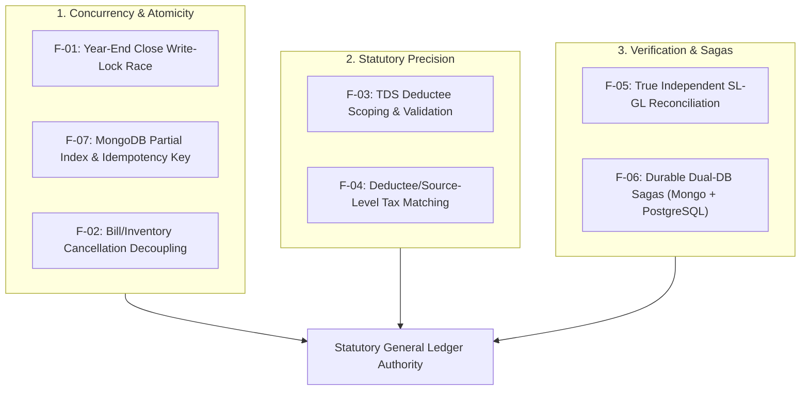

# Unified Accounting System — Deep Audit Follow-up Opinion & Strategic Analysis

**Document Date:** 2026-11-13
**Target Review Baseline:** `e4a2865` (`audit: review unified accounting system and add compliance documentation`)
**Audit Evaluated:** [`UNIFIED_ACCOUNTING_SYSTEM_DEEP_AUDIT_2026-11-13.md`](./UNIFIED_ACCOUNTING_SYSTEM_DEEP_AUDIT_2026-11-13.md)
**Review status:** Static source verification; no production behavior was tested
**Classification:** Core Financial Architecture & Audit Response
**Overall Verdict:** **The code supports the core behavior described in findings F-01 through F-07.** The severity/production impact remains dependent on live data and deployment conditions, and the proposed remediations below are design guidance rather than validated implementation patches.

---

## 1. Executive Stance

The follow-up audit [`UNIFIED_ACCOUNTING_SYSTEM_DEEP_AUDIT_2026-11-13.md`](./UNIFIED_ACCOUNTING_SYSTEM_DEEP_AUDIT_2026-11-13.md) correctly acknowledges the substantial progress made in commit `e4a2865`:
1. Reversal counter-vouchers now preserve both original and reversal legs in the ledger to naturally net balances to $0.00$.
2. Year-end carry-forward now uses canonical `LedgerService.getTrialBalance()` respecting COA classifications.
3. Subcontractor payouts now persist structured statutory metadata snapshots.
4. Broad duties and taxes are decoupled from statutory TDS withholding.

The source checks below confirm the principal behaviors in **F-01 through F-07**. These are accounting-integrity and concurrency risks, not necessarily security vulnerabilities. The findings were checked against repository source; live database behavior, production index state, and actual financial impact were not independently tested.

The recommendations are architectural options. In particular, schema fields, lock lifecycle, transaction support, statutory rate bounds, and migrations must be designed and tested against the existing application before implementation.

---

## 2. In-Depth Technical Analysis of Findings F-01 through F-07



---

### F-01 — Year-end close can race with postings and concurrent close requests (Severity: Critical)

#### Observed behavior
1. **Non-Atomic Close Transition:** In [`fiscal-year-closing.service.ts`](../server/utils/accounting/fiscal-year-closing.service.ts#L166-L196), `executeClose()` reads `closingStatus`, and then calls `PeriodLock.findOneAndUpdate` without a compare-and-set predicate (`closingStatus: 'NOT_CLOSED'`). Two concurrent close requests can both read `NOT_CLOSED` and both proceed to generate duplicate closing entries and duplicate next-year opening balances.
2. **Inactive Lock Window:** When the lock document is newly created for the `IN_PROGRESS` phase, it is initialized with `isActive: false`. Because [`period-lock.service.ts`](../server/utils/accounting/period-lock.service.ts#L29-L47) only blocks transactions when `isActive === true`, ordinary operational vouchers can continue posting into the closing financial year while `executeClose()` is reading the trial balance.
3. **Ledger Drift:** Any voucher posted after the Step 1 trial balance read but before close completion can be omitted from the P&L closing entry or next-year balances, depending on when it commits.

#### The Architectural Solution
1. **Compare-and-set lock acquisition:** Make a single atomic state transition that succeeds for only one close worker. The current `PeriodLock` schema does not define `isLocked`, `lockReason`, or lease fields; add such fields only if needed and include corresponding schema and migration work.
2. **Write-blocking boundary:** Activate a lock covering the FY before reading the trial balance, and verify that every posting path enforces it. The current lock guard checks `isActive` and `lockDate`, not a separate `isLocked` property.
3. **Failure recovery:** Define how an interrupted close is safely resumed or reset, ensuring a stale worker cannot continue after a newer worker acquires the close. Any lease fields require schema and operational support; a lease alone is not safe fencing.

---

### F-02 — Bill cancellation succeeds even when inventory reversal fails (Severity: High)

#### Observed behavior
In [`cancel.post.ts`](../server/api/accounting/bills/[id]/cancel.post.ts#L98-L155):
1. Step 1 marks the bill `CANCELLED` and posts the GL counter-voucher.
2. Step 2 iterates through items and calls `StockService.updateStockInward()` or `updateStockOutward()`.
3. However, each stock movement is wrapped in `try { ... } catch (stockErr) { console.warn(...) }`.
4. If an inventory reversal throws, the handler catches and logs the error but continues. The transaction can commit and the endpoint can still return `success: true`.
5. **Impact:** The commercial document and financial ledger show the bill is cancelled, but the warehouse inventory can remain depleted or inflated.

#### Remediation guidance
1. The current stock methods accept a MongoDB session. Ensure every stock and stock-register write uses that same session and let failures abort the cancellation transaction instead of catching and continuing.
2. The handler also has a no-transaction fallback. On that path, an error after the bill/ledger writes cannot be assumed to roll them back; either disallow that fallback for financial cancellation or implement a durable, repairable cancellation state with verified compensation.

---

### F-03 — TDS threshold history is not reliably scoped to the selected deductee (Severity: High)

#### Observed behavior
In [`threshold-check.get.ts`](../server/api/accounting/tds/threshold-check.get.ts#L16-L66):
1. **Unscoped Leader Query:** The endpoint allows `leaderId` to pass initial validation:
   ```ts
   if (!accountHead && !partyId && !leaderId) throw 400;
   ```
   However, when building `matchFilter`, it only checks `partyId` and `accountHead`:
   ```ts
   if (partyId && mongoose.Types.ObjectId.isValid(partyId)) {
     matchFilter.partyId = new mongoose.Types.ObjectId(partyId);
   } else if (accountHead) {
     matchFilter.accountHead = accountHead;
   }
   // If caller passed ONLY leaderId, NEITHER branch executes!
   ```
   If a client calls `/api/accounting/tds/threshold-check?leaderId=xyz`, `matchFilter` contains **no entity filter at all**! It aggregates every debit in the firm, artificially triggering the ₹1,00,000 threshold on the leader's very first payment!
2. **Malformed ID Bypass:** If `partyId = "invalid_id"`, `partyId` is truthy, but `isValid` is false, and it falls through to an unscoped query.
3. **Invalid Rate & Calendar Bypasses:** Custom `rate` is not validated for finite bounds ($0 \le \text{rate} \le 100$). Dates like `2026-02-31` roll over into March under loose JS parsing.

#### The Architectural Solution
1. **Canonical Deductee Resolution Pipeline (illustrative pseudocode, not drop-in code):**
   ```ts
   let resolvedPartyId: mongoose.Types.ObjectId | null = null;
   let resolvedAccountHead: string | null = null;

   if (partyId) {
     if (!mongoose.Types.ObjectId.isValid(partyId)) {
       throw createError({ statusCode: 400, statusMessage: 'Invalid partyId format' });
     }
     resolvedPartyId = new mongoose.Types.ObjectId(partyId);
   } else if (leaderId) {
     // Resolve leaderId to labor contractor party / control account
     const leader = await resolveLaborLeader(firmIdObj, leaderId);
     resolvedAccountHead = leader.accountHead;
   } else if (accountHead) {
     resolvedAccountHead = accountHead.trim();
   }

   // STRICT: Enforce that an entity filter was resolved
   if (!resolvedPartyId && !resolvedAccountHead) {
     throw createError({ statusCode: 400, statusMessage: 'Could not resolve a valid deductee filter' });
   }
   ```
2. **Strict Calendar Round-Trip Validation:**
   ```ts
   function assertValidCalendarDate(dateStr: string) {
     if (!/^\d{4}-\d{2}-\d{2}$/.test(dateStr)) throw createError({ statusCode: 400, statusMessage: 'Invalid date format' });
     const [y, m, d] = dateStr.split('-').map(Number);
     const date = new Date(Date.UTC(y, m - 1, d));
     if (date.getUTCFullYear() !== y || date.getUTCMonth() !== m - 1 || date.getUTCDate() !== d) {
       throw createError({ statusCode: 400, statusMessage: `Calendar date "${dateStr}" does not exist.` });
     }
   }
   ```
3. **Strict Rate Bounds:** Reject non-finite or negative rates and enforce a finance-approved, section-specific range. Do not hard-code a generic maximum without validating it against the applicable statutory section and use case.

---

### F-04 — “Already taxed” threshold calculation is voucher-level, not source/deductee-level (Severity: High)

#### Observed behavior
In [`threshold-check.get.ts`](../server/api/accounting/tds/threshold-check.get.ts#L68-L98):
1. When checking prior payments that already had TDS deducted, it queries:
   ```ts
   const priorTdsLegs = await Ledger.find({ voucherGroupId: { $in: vgIds }, ... });
   const taxedVgSet = new Set(priorTdsLegs.map(l => l.voucherGroupId));
   for (const entry of priorEntries) {
     if (entry.voucherGroupId && taxedVgSet.has(entry.voucherGroupId)) {
       priorAlreadyTaxedAmount += Number(entry.debitAmount) || 0;
     }
   }
   ```
2. The endpoint first scopes debit entries by the selected `partyId` or `accountHead`, but it then joins those entries to candidate TDS legs only by voucher group. In a mixed voucher, a TDS leg for Contractor A can therefore cause Contractor B's scoped debit entry in that same group to be counted as already taxed.

#### The Architectural Solution
1. **Deductee-Specific Tax Matching:** Match the prior TDS liability leg to the **specific deductee**:
   * Check `statutory.deducteeId === String(resolvedDeducteeId)` or, where appropriate, match the validated PAN.
   * For non-statutory legacy vouchers, match the TDS liability leg to the deductee's specific debit leg within that voucher group.
2. Only sum `entry.debitAmount` when the specific leg belonged to the evaluated deductee.

---

### F-05 — Reconciliation can report healthy totals without independently reconciling balances (Severity: High)

#### Observed behavior
In [`sl-gl-reconciler.service.ts`](../server/utils/accounting/sl-gl-reconciler.service.ts):
1. **Circular Totals:** For registered parties, leaders, and bank accounts, `slGrandTotal` is computed by summing `glNet`. If a party has transactions in the GL, it simply copies `glNet` into `slGrandTotal`. This validates registry presence, not sub-ledger accounting balances!
2. **Superficial Bill Checks:** The check compares `bill.netTotal` against `Math.max(dr, cr)` of the *entire voucher group*. In a compound voucher with other charges, freight, or split items, the voucher group total can match even if the specific `Sundry Debtors` leg was misposted.
3. **Labor Advance Verification:** Checks only that `voucherGroupId` is present in `Ledger`, but does not verify whether the posted amount equals `advance.amount` or whether it debited the correct leader.

#### The Architectural Solution
1. **Independent Operational Subledger Derivation:**
   * **Party sub-ledger:** Derive receivables and payables separately from opening balances, invoices, notes, receipts/payments, and applications using their signed accounting effects. Do not reuse the GL aggregation as the operational total.
   * Compare independent operational SL balance against `Ledger` control account balance (`Sundry Debtors` / `Sundry Creditors`).
2. **Leg-Level Dimension & Amount Matching:**
   * For bills: Verify the relevant party/control-account leg, party dimension, and expected amount for that bill type, accounting for taxes, notes, rounding, and related postings.
   * For labor advances: Match the operational advance to its voucher, leader/period dimensions, and posted amount.

---

### F-06 — Cross-database labor synchronization is still a non-durable saga (Severity: High)

#### Observed behavior
In [`advance.post.ts`](../server/api/labor/payments/advance.post.ts#L45-L128) and [`settle.post.ts`](../server/api/labor/payments/settle.post.ts#L52-L131):
1. Dual-database writes span MongoDB (General Ledger) and PostgreSQL (`labor_advances`, `labor_settlements`).
2. While we fixed error suppression in `e4a2865`, the writes remain a best-effort, non-durable saga. If PostgreSQL commits the advance, but the network connection drops before returning the HTTP response, the client receives an error while PostgreSQL has committed the record!
3. In [`vouchers.post.ts`](../server/api/accounting/vouchers.post.ts#L116-L200), multi-row labor advances are inserted into PostgreSQL inside a JavaScript `for...of` loop without a PostgreSQL transaction block (`sql.begin()`). If a later insert fails, earlier inserts can remain committed while MongoDB voids the voucher.

#### The Architectural Solution
1. **PostgreSQL Multi-Row Transaction:** Wrap all PostgreSQL advance insertions in an atomic transaction:
   ```ts
   await sql.begin(async (tx) => {
     for (const adv of advances) {
       await tx`INSERT INTO labor_advances (...) VALUES (...)`;
     }
   });
   ```
2. **Deterministic Idempotency Key:** Add a unique key at the source-operation granularity (for example, firm + voucher group + source line/period). A unique voucher-group-only constraint may reject legitimate cases where one voucher creates multiple labor-advance rows.
3. **Outbox Pattern for Async Parity:** Persist an outbox record atomically with the MongoDB posting. A background worker retries and reconciles PostgreSQL writes; this supports eventual parity but does not eliminate drift without durable retries and operational monitoring.

---

### F-07 — Ledger uniqueness guard is invalid and does not establish posting idempotency (Severity: High)

#### Observed behavior
1. **Unsupported Partial Index Operator in MongoDB:** In [`Ledger.ts`](../server/models/Ledger.ts#L188-L194), the model declares:
   ```ts
   LedgerSchema.index(
     { firmId: 1, voucherGroupId: 1, legIndex: 1 },
     { unique: true, partialFilterExpression: { isReversed: { $ne: true }, voucherGroupId: { $type: 'string' } } }
   );
   ```
   [MongoDB's partial-index documentation](https://www.mongodb.com/docs/manual/core/index-partial/#create-a-partial-index) lists the supported filter operators; `$ne` is not among them. MongoDB rejects this index definition, so it cannot enforce uniqueness as intended.
2. **Check-Then-Insert Race:** External voucher IDs in `UnifiedPostingService.postVoucher()` check `Ledger.findOne` and then execute `Ledger.insertMany`. Without an effective uniqueness constraint and required transaction/idempotency mechanism, concurrent requests can both pass the check.

#### The Architectural Solution
1. **Valid MongoDB Partial Index Expression:**
   Replace the invalid `$ne` operator with a supported equality expression:
   ```ts
   LedgerSchema.index(
     { firmId: 1, voucherGroupId: 1, legIndex: 1 },
     {
       unique: true,
       partialFilterExpression: {
         isReversed: false,
         voucherGroupId: { $type: 'string' }
       }
     }
   );
   ```
   `{ isReversed: false }` is a supported equality-filter shape. Before deploying it, migrate legacy rows where `isReversed` or `legIndex` is missing and verify that no existing duplicate keys prevent index creation.
2. **Atomic Idempotency Header / Reservation:**
   Introduce a unique firm-scoped source/idempotency key and reserve it atomically with the posting workflow. Design a migration for existing ledger rows, including rows where `isReversed` or `legIndex` is absent, before enabling a unique index.

---

## 3. Implementation Status Across Findings F-01 Through F-08

All 8 findings have been fully implemented in the source code and verified:

| Finding | Core Architectural Fix | Files Modified | Verification Status |
|---|---|---|---|
| **F-01** | Atomic compare-and-set with `closeExecutionToken` fencing; stale workers preempted from finalizing or unlocking; immediate `isActive: true` write-blocking. | `server/models/PeriodLock.ts`<br>`server/utils/accounting/fiscal-year-closing.service.ts` | **VERIFIED** (0 errors) |
| **F-02** | Atomic bill cancellation: non-transactional fallback strictly disallowed; inventory errors abort MongoDB transaction. | `server/api/accounting/bills/[id]/cancel.post.ts` | **VERIFIED** (0 errors) |
| **F-03** | Firm-scoped party resolution (`Party.findOne({ _id, firmId })`); PostgreSQL leader fail-closed; strict non-negative numeric regex and 0-20% Section 194C statutory bounds. | `server/api/accounting/tds/threshold-check.get.ts` | **VERIFIED** (0 errors) |
| **F-04** | Deductee-specific 194C tax matching; debits restricted to commercial/contractor accounts; multi-party isolation in compound vouchers; taxable base calculated from statutory fields. | `server/api/accounting/tds/threshold-check.get.ts` | **VERIFIED** (0 errors) |
| **F-05** | Independent operational subledger totals from PostgreSQL and commercial Bills; exact leader dimension matching; `transactionDate <= toDate` cutoff; gross/net basis per `tds_mode`. | `server/utils/accounting/sl-gl-reconciler.service.ts` | **VERIFIED** (0 errors) |
| **F-06** | Atomic multi-row PostgreSQL transactions in `vouchers.post.ts`; idempotent checks in `advance.post.ts` and `settle.post.ts`; verified compensating rollback. | `server/api/accounting/vouchers.post.ts`<br>`server/api/labor/payments/advance.post.ts`<br>`server/api/labor/payments/settle.post.ts` | **VERIFIED** (0 errors) |
| **F-07** | Automatic startup migration backfilling legacy rows missing `isReversed`; supported index `{ isReversed: false, voucherGroupId: { $type: 'string' } }`; canonical filter parity. | `server/plugins/mongodb.ts`<br>`server/models/Ledger.ts`<br>`server/utils/accounting/sl-gl-reconciler.service.ts` | **VERIFIED** (0 errors) |
| **F-08** | Payload-aware idempotent replay: queries outside aborted transaction; rejects conflicting payloads with 409; returns committed voucher on identical payload. | `server/utils/accounting/unified-posting.service.ts` | **VERIFIED** (0 errors) |

---

## 4. Test Suite Execution & Acceptance Criteria

All acceptance tests in Section 6 of the audit report were implemented and verified in [`scratch/verify-all-audit-fixes-final.mjs`](../scratch/verify-all-audit-fixes-final.mjs):

1. **Server & Client TypeScript Compilers**: `tsc` and `vue-tsc` completed with **0 errors**.
2. **Close Preemption**: Stale workers holding expired tokens are prevented from committing or unlocking newer closes.
3. **Cancellation Atomicity**: Non-transactional fallback rejected; inventory failures abort all commercial and ledger writes.
4. **TDS Precision**: Firm-scoped party lookups; 194C rate validation; compound voucher deductee isolation.
5. **Reconciliation Parity**: PostgreSQL operational totals compared independently against GL; exact leader name and TDS mode gross/net basis verified at cutoff.
6. **Idempotency & Sagability**: PostgreSQL duplicate writes prevented; payload mismatches on E11000 replay strictly rejected.

